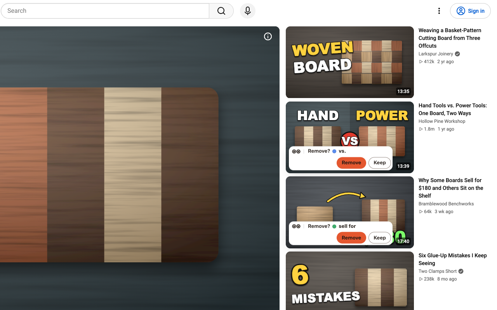
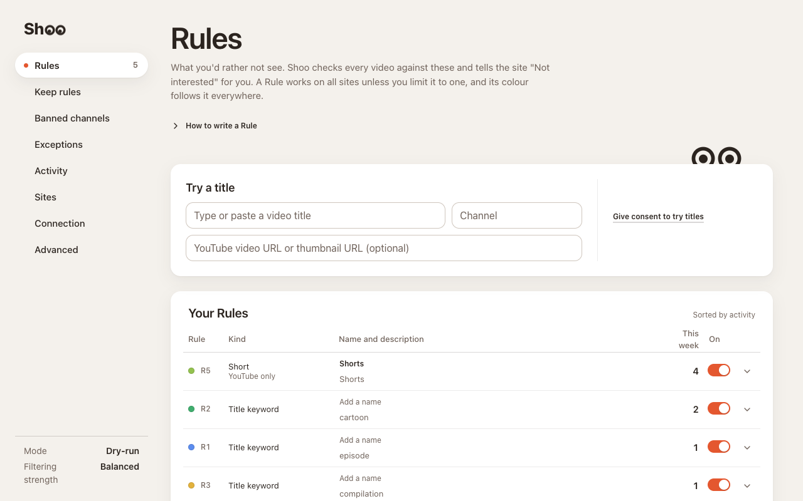
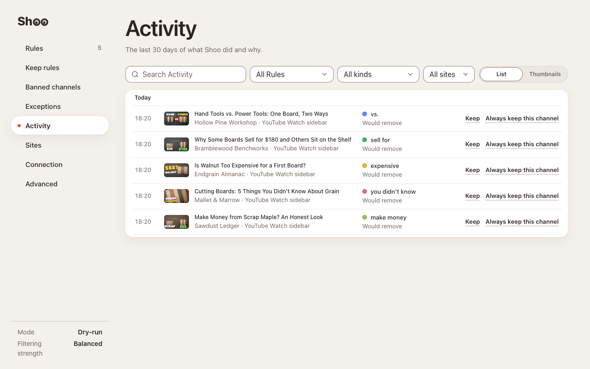
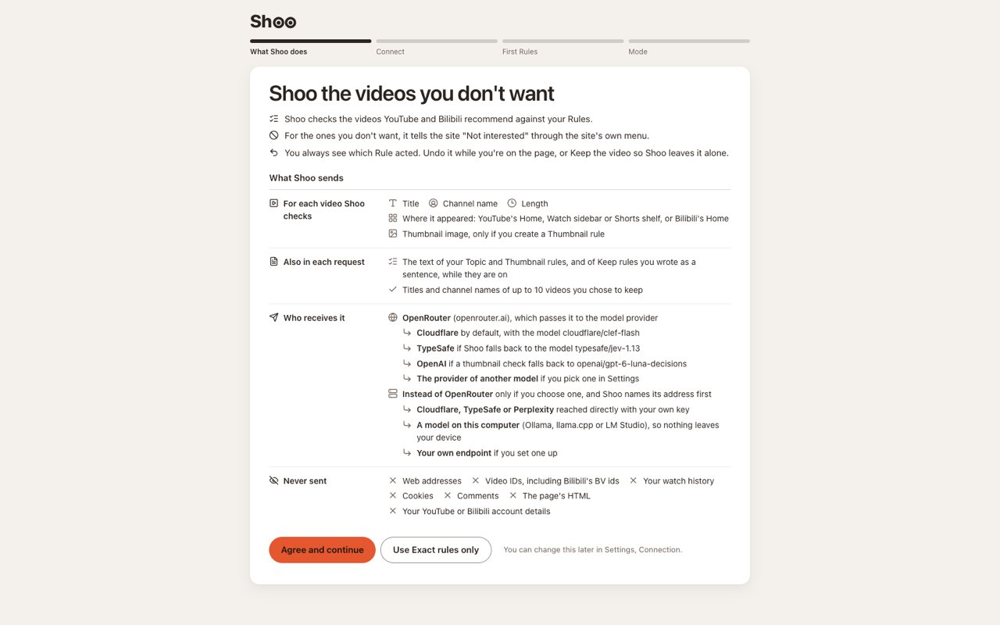
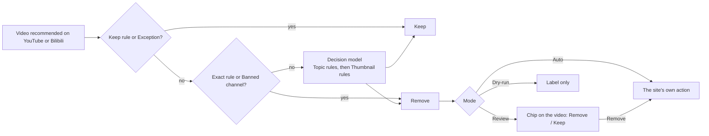

# Shoo

**English** · [简体中文](docs/i18n/README.zh-CN.md) · [Español](docs/i18n/README.es.md) · [Deutsch](docs/i18n/README.de.md) · [Français](docs/i18n/README.fr.md) · [日本語](docs/i18n/README.ja.md)

Shoo is a Chrome and Firefox extension that clears unwanted recommendations on YouTube and Bilibili. You write Rules in plain language, Shoo checks each recommended video against them, and when one matches it uses the site's own **Not interested** or **Don't recommend channel**, so the site learns from it. Every removal names the Rule that caused it. While you're still on the page, one click undoes it, and Keep stops Shoo removing that video again.

Shoo is not affiliated with or endorsed by YouTube, Google or Bilibili.

<p align="center">
  
</p>

| Your Rules | What Shoo did | First run |
|---|---|---|
|  |  |  |

The top screenshot and What Shoo did were taken on a real youtube.com Watch page, with every video title, channel, view count, age, thumbnail and avatar swapped for made-up ones before the page loaded. Video streams were blocked, so the player shows a drawn still, and its controls, play button and watermark were hidden. Shoo ran on that page unchanged, with keyword Rules. Your Rules shows synthetic Rules.

## How it works



- **Rules.** A Topic rule is one plain-language sentence, such as "Reaction videos, where someone watches and reacts to other content". A Thumbnail rule describes what a thumbnail shows. Exact rules match a channel, a title keyword or pattern, a length, a view count, Shorts or live streams on your device, without any model. Keep rules protect what you always want, and Keep on a single video adds an Exception. A remove Rule can be set to skip YouTube channels you're subscribed to.
- **Decision model.** Topic and Thumbnail rules are judged by a Decision model, a model that answers typed questions with probabilities. By default that is `cloudflare/clef-flash` through OpenRouter's Decisions API with your own OpenRouter key. You can instead reach Cloudflare, TypeSafe or Perplexity directly with their key, or run a Decision model on your computer with Ollama, llama.cpp or LM Studio. Settings also accepts an OpenAI-compatible chat model, marked less accurate. Filtering strength (Cautious, Balanced, Eager) sets how sure the model must be before a Rule removes a video.
- **The site's own actions.** Shoo never hides anything. It opens the video's menu and clicks Not interested, or Don't recommend channel for a Banned channel, which needs you to be signed in to YouTube. On Bilibili these are 内容不感兴趣 and 不想看此UP主.
- **Modes.** Review asks on the video first. Auto removes straight away. Dry-run only labels what it would do.
- **Where.** YouTube's Home page, the Watch page sidebar and the Shorts shelf, and Bilibili's Home page, on desktop. You can turn either site off in Settings, Sites. Two optional switches also tell YouTube to show fewer Shorts and games shelves on Home.
- **Rules work on both sites** unless you limit one to YouTube or Bilibili when you add it, or later from its row. A channel Rule made from a video (Always keep this channel, or a ban suggested by Escalation) works only on that video's site, and Short, Live, Artist channel and view count rules only on YouTube.

You pay the provider through your own key. With OpenRouter and clef-flash, calibration with 10 Topic rules measured about 2.5 US cents per 1,000 videos, less with fewer Rules. Shoo remembers each answer, so a video is not sent twice under the same Rules, and a daily cap limits how many videos go to the model in a day.

## Privacy

Nothing goes to a model provider until you agree on the first screen, and "Use Exact rules only" sends nothing to one at all. Besides the model requests, Shoo contacts only the sites it works on. It loads thumbnails from YouTube's and Bilibili's image servers, to check them against a Thumbnail rule and to show them on Shoo's own pages. When a Rule is set to skip channels you're subscribed to, Shoo reads your YouTube subscriptions page, signed in as you, and keeps the list on your device.

After you agree, Shoo sends for each video its title, channel name, length and where on YouTube or Bilibili it appeared, and the thumbnail only if you have a Thumbnail rule. Each request also carries the text of your Topic, Topic Keep and Thumbnail rules that work on that site and the titles and channel names of up to 10 videos you kept. It goes to the Decision provider you chose: OpenRouter and the model provider it routes to (Cloudflare by default, TypeSafe or OpenAI as fallbacks, or the provider of another model you pick), Cloudflare, TypeSafe or Perplexity directly, or a model on your computer, where nothing leaves the device. A chat model you set up in Settings gets the same data instead, without thumbnails.

Shoo never sends a model provider web addresses, video IDs, cookies, watch history, comments or account details. Nothing goes to the developer, and there is no analytics. The full list, storage and retention are in the [privacy policy](https://laoweek.github.io/shoo/release/privacy-policy.html). Questions: shoo@piran.xyz.

## Status

Pre-release, version 0.2.0. Shoo is not yet in the Chrome Web Store or on Firefox Add-ons, so install it from source.

- Connect OpenRouter (OAuth sign-in) has not been tested live yet. You can paste an OpenRouter key instead.
- The direct Decision providers were tested against stand-in servers that follow each provider's documented rules, not with real keys.

## Build and install from source

You need Node 24 (see [`.nvmrc`](.nvmrc)) and pnpm 11.9.0, which Corepack provides from `package.json`.

```sh
corepack enable
pnpm install --frozen-lockfile
pnpm build            # Chrome, written to .output/chrome-mv3/
pnpm build:firefox    # Firefox, written to .output/firefox-mv3/
```

- **Chrome 120 or later:** open `chrome://extensions`, turn on Developer mode, choose **Load unpacked** and select `.output/chrome-mv3/`.
- **Firefox 140 or later (desktop):** open `about:debugging#/runtime/this-firefox`, choose **Load Temporary Add-on** and select `.output/firefox-mv3/manifest.json`. A temporary add-on stays until Firefox restarts. Release builds of Firefox install only signed add-ons permanently.

`pnpm zip` and `pnpm zip:firefox` write store packages to `.output/`. The Firefox command also writes the sources zip that AMO reviewers rebuild from, as described in [README-SOURCES.md](README-SOURCES.md).

## Builds and releases

[CI](.github/workflows/ci.yml) runs `pnpm check` on every pull request and every push to `main`. Every push to `main` then builds the distribution packages: the Chrome zip, the Firefox zip and the Firefox sources zip. Download them from the workflow run's artifacts.

To release, set `version` in `package.json`, commit, then push a matching tag:

```sh
git tag v0.2.0
git push origin v0.2.0
```

CI checks that the tag matches `package.json` and publishes a GitHub Release with the three zips. Uploading to the Chrome Web Store and Firefox Add-ons is a manual step. The listing copy and store forms are in [docs/release/](docs/release/).

## Development

```sh
pnpm dev              # Chrome with the extension loaded, reloads on change
pnpm dev:firefox      # the same in Firefox
pnpm check            # what CI runs on every pull request and push
```

`pnpm check` runs the TypeScript typecheck, ESLint, the unit tests (Vitest), both browser builds and the size budgets (`scripts/check-size.mjs`). The unit tests use recorded responses in `test/fixtures/` and never call a model.

Live tests are opt-in and spend a little OpenRouter credit (at most about $0.01 a run). Put `OPENROUTER_API_KEY=...` in `.env.local`, which is git-ignored, and run `pnpm test:live`. Never commit a key.

The calibration harness in [`scripts/calibration/`](scripts/calibration/README.md) measures how well a Decision model and request shape judge a fixed set of synthetic labelled videos. Its results set the Filtering strength presets. Its live runs also spend credit, within a cap you set.

## Docs

| Read | For |
|---|---|
| [CONTEXT.md](CONTEXT.md) | The words used in code, docs and UI (Tile, Surface, Rule, Verdict, Exception…) |
| [docs/spec/](docs/spec/) | Requirements and the specs for architecture, the Decision engine, YouTube and Bilibili integration, UI and store releases. The source of truth for behaviour |
| [docs/adr/](docs/adr/) | Why the hard-to-reverse decisions were made |
| [DESIGN.md](DESIGN.md) | The visual system, generated from the build |
| [PRODUCT.md](PRODUCT.md) | Who Shoo is for and what it promises |
| [AGENTS.md](AGENTS.md) | Working rules and gotchas for contributors and coding agents |

## Contributing

See [CONTRIBUTING.md](CONTRIBUTING.md). To report a security problem, see [SECURITY.md](SECURITY.md).

## Licence

Apache-2.0. See [LICENSE](LICENSE). Bundled third-party code, icons and fonts keep their own licences, listed in [THIRD_PARTY_NOTICES.md](THIRD_PARTY_NOTICES.md).
