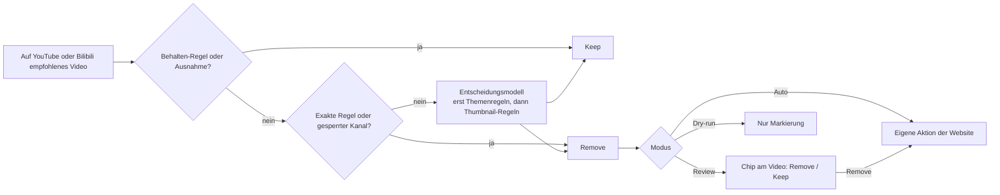

# Shoo

[English](../../README.md) · [简体中文](README.zh-CN.md) · [Español](README.es.md) · **Deutsch** · [Français](README.fr.md) · [日本語](README.ja.md)

Maßgeblich ist das [englische README](../../README.md), und diese Übersetzung kann ihm hinterherhinken.

Shoo ist eine Erweiterung für Chrome und Firefox, die unerwünschte Empfehlungen auf YouTube und Bilibili wegräumt. Du schreibst Regeln (Rules) in normaler Sprache, Shoo prüft jedes empfohlene Video daran, und wenn eines passt, nutzt Shoo das eigene **Not interested** (Kein Interesse) oder **Don't recommend channel** (Kanal nicht empfehlen) der Website, damit die Website daraus lernt. Jede Entfernung nennt die Regel, die sie ausgelöst hat. Solange du noch auf der Seite bist, macht ein Klick sie rückgängig, und Keep sorgt dafür, dass Shoo das Video nicht wieder entfernt.

Shoo steht in keiner Verbindung zu YouTube, Google oder Bilibili und wird von ihnen nicht unterstützt.

<p align="center">
  
</p>

| Deine Regeln | Was Shoo getan hat | Erster Start |
|---|---|---|
|  |  |  |

Der obere Screenshot und „Was Shoo getan hat“ stammen von einer echten Wiedergabeseite auf youtube.com. Alle Videotitel, Kanäle, Aufrufzahlen, Altersangaben, Vorschaubilder und Profilbilder wurden vor dem Laden durch erfundene ersetzt. Videostreams wurden blockiert, daher zeigt der Player ein gezeichnetes Standbild, und seine Steuerleiste, Wiedergabetaste und sein Wasserzeichen wurden ausgeblendet. Shoo lief unverändert auf dieser Seite, mit Stichwort-Regeln. „Deine Regeln“ zeigt erfundene Regeln.

## So funktioniert es



- **Regeln.** Eine Themenregel (Topic rule) ist ein einziger Satz in normaler Sprache, zum Beispiel „Reaction-Videos, in denen jemand andere Inhalte anschaut und darauf reagiert“. Eine Thumbnail-Regel (Thumbnail rule) beschreibt, was ein Thumbnail zeigt. Exakte Regeln (Exact rules) treffen auf deinem Gerät und ganz ohne Modell auf einen Kanal, ein Stichwort oder Muster im Titel, eine Länge, eine Aufrufzahl, Shorts oder Livestreams zu. Behalten-Regeln (Keep rules) schützen, was du immer sehen willst, und Keep (Behalten) bei einem einzelnen Video fügt eine Ausnahme (Exception) hinzu. Eine Entfernen-Regel lässt sich so einstellen, dass sie YouTube-Kanäle überspringt, die du abonniert hast.
- **Entscheidungsmodell.** Themen- und Thumbnail-Regeln beurteilt ein Entscheidungsmodell (Decision model), also ein Modell, das typisierte Fragen mit Wahrscheinlichkeiten beantwortet. Standardmäßig ist das `cloudflare/clef-flash` über die Decisions API von OpenRouter, mit deinem eigenen OpenRouter-Schlüssel. Du kannst stattdessen Cloudflare, TypeSafe oder Perplexity direkt mit deren Schlüssel ansprechen oder ein Entscheidungsmodell mit Ollama, llama.cpp oder LM Studio auf deinem Computer laufen lassen. Settings (Einstellungen) akzeptiert auch ein OpenAI-kompatibles Chat-Modell, das als weniger genau gekennzeichnet ist. Die Filterstärke (Filtering strength: Cautious, Balanced, Eager, also vorsichtig, ausgewogen, eifrig) legt fest, wie sicher sich das Modell sein muss, bevor eine Regel ein Video entfernt.
- **Die eigenen Aktionen der Website.** Shoo blendet nie etwas aus. Es öffnet das Menü des Videos und klickt auf Not interested, bei einem gesperrten Kanal (Banned channel) auf Don't recommend channel, wofür du bei YouTube angemeldet sein musst. Auf Bilibili heißen sie 内容不感兴趣 und 不想看此UP主.
- **Modi.** Review (Prüfen) fragt erst am Video nach. Auto (Automatisch) entfernt sofort. Dry-run (Probelauf) markiert nur, was es tun würde.
- **Wo.** Auf der YouTube-Startseite, in der Seitenleiste der Wiedergabeseite und im Shorts-Regal sowie auf der Bilibili-Startseite, am Desktop. Du kannst jede der beiden Websites in Settings, Sites (Einstellungen, Websites) ausschalten. Zwei optionale Schalter sagen YouTube außerdem, dass es auf der Startseite weniger Shorts- und Spiele-Regale zeigen soll.
- **Regeln gelten auf beiden Websites**, außer du beschränkst eine beim Hinzufügen oder später in ihrer Zeile auf YouTube oder Bilibili. Eine Kanalregel, die aus einem Video entsteht (Always keep this channel, also diesen Kanal immer behalten, oder eine von der Eskalation (Escalation) vorgeschlagene Sperre), gilt nur auf der Website dieses Videos, und Regeln für Shorts, Livestreams, Künstlerkanäle (Artist channel) und Aufrufzahlen gelten nur auf YouTube.

Du bezahlst den Anbieter über deinen eigenen Schlüssel. Mit OpenRouter und clef-flash ergab die Kalibrierung mit 10 Themenregeln etwa 2,5 US-Cent pro 1.000 Videos, mit weniger Regeln weniger. Shoo merkt sich jede Antwort, sodass ein Video unter denselben Regeln nicht zweimal gesendet wird, und ein Tageslimit begrenzt, wie viele Videos an einem Tag an das Modell gehen.

## Datenschutz

Nichts geht an einen Modellanbieter, bevor du auf dem ersten Bildschirm zustimmst, und „Use Exact rules only“ (Nur exakte Regeln verwenden) sendet überhaupt nichts an einen. Außer den Anfragen an das Modell kontaktiert Shoo nur die Seiten, auf denen es arbeitet. Thumbnails lädt es von den Bildservern von YouTube und Bilibili, um sie mit einer Thumbnail-Regel zu prüfen und auf Shoos eigenen Seiten zu zeigen. Wenn eine Regel so eingestellt ist, dass sie Kanäle überspringt, die du abonniert hast, liest Shoo deine YouTube-Abo-Seite, angemeldet als du, und behält die Liste auf deinem Gerät.

Nachdem du zugestimmt hast, sendet Shoo für jedes Video den Titel, den Kanalnamen, die Länge und die Stelle auf YouTube oder Bilibili, an der es erschienen ist, und das Thumbnail nur, wenn du eine Thumbnail-Regel hast. Jede Anfrage enthält außerdem den Text deiner Themenregeln, Themen-Behalten-Regeln (Topic Keep rules) und Thumbnail-Regeln, die auf dieser Website gelten, sowie die Titel und Kanalnamen von bis zu 10 Videos, die du behalten hast. Das geht an den Entscheidungsanbieter (Decision provider), den du gewählt hast: OpenRouter und den Modellanbieter, an den OpenRouter weiterleitet (standardmäßig Cloudflare, ersatzweise TypeSafe oder OpenAI, oder der Anbieter eines anderen Modells, das du auswählst), Cloudflare, TypeSafe oder Perplexity direkt, oder ein Modell auf deinem Computer, bei dem nichts das Gerät verlässt. Ein Chat-Modell, das du in Settings einrichtest, bekommt stattdessen dieselben Daten, ohne Thumbnails.

Shoo sendet einem Modellanbieter nie Webadressen, Video-IDs, Cookies, Wiedergabeverlauf, Kommentare oder Kontodaten. Nichts geht an den Entwickler, und es gibt keine Analyse-Tools. Die vollständige Liste, Speicherung und Aufbewahrung stehen in der [Datenschutzerklärung](https://laoweek.github.io/shoo/release/privacy-policy.html). Fragen: shoo@piran.xyz.

## Status

Vorabversion, Version 0.2.0. Shoo ist noch nicht im Chrome Web Store oder bei Firefox Add-ons, also installiere es aus dem Quellcode.

- Connect OpenRouter (Anmeldung per OAuth) wurde noch nicht live getestet. Du kannst stattdessen einen OpenRouter-Schlüssel einfügen.
- Die direkten Entscheidungsanbieter wurden gegen Ersatzserver getestet, die sich an die dokumentierten Regeln des jeweiligen Anbieters halten, nicht mit echten Schlüsseln.

## Aus dem Quellcode bauen und installieren

Du brauchst Node 24 (siehe [`.nvmrc`](../../.nvmrc)) und pnpm 11.9.0, das Corepack anhand von `package.json` bereitstellt.

```sh
corepack enable
pnpm install --frozen-lockfile
pnpm build            # Chrome, written to .output/chrome-mv3/
pnpm build:firefox    # Firefox, written to .output/firefox-mv3/
```

- **Chrome 120 oder neuer:** Öffne `chrome://extensions`, schalte Developer mode (Entwicklermodus) ein, wähle **Load unpacked** (Entpackte Erweiterung laden) und dann `.output/chrome-mv3/`.
- **Firefox 140 oder neuer (Desktop):** Öffne `about:debugging#/runtime/this-firefox`, wähle **Load Temporary Add-on** (Temporäres Add-on laden) und dann `.output/firefox-mv3/manifest.json`. Ein temporäres Add-on bleibt, bis Firefox neu startet. Release-Versionen von Firefox installieren nur signierte Add-ons dauerhaft.

`pnpm zip` und `pnpm zip:firefox` schreiben Store-Pakete nach `.output/`. Der Firefox-Befehl schreibt außerdem das Quellcode-Zip, aus dem die AMO-Prüfer die Erweiterung neu bauen, wie in [README-SOURCES.md](../../README-SOURCES.md) beschrieben.

## Builds und Releases

Die [CI](../../.github/workflows/ci.yml) führt `pnpm check` bei jedem Pull Request und jedem Push auf `main` aus. Jeder Push auf `main` baut danach die Distributionspakete: das Chrome-Zip, das Firefox-Zip und das Firefox-Quellcode-Zip. Du kannst sie aus den Artefakten des Workflow-Laufs herunterladen.

Für ein Release setzt du `version` in `package.json`, committest und pushst dann einen passenden Tag:

```sh
git tag v0.2.0
git push origin v0.2.0
```

Die CI prüft, ob der Tag zu `package.json` passt, und veröffentlicht ein GitHub Release mit den drei Zips. Das Hochladen in den Chrome Web Store und zu Firefox Add-ons ist ein manueller Schritt. Die Texte für die Store-Einträge und die Store-Formulare liegen in [docs/release/](../release/).

## Entwicklung

```sh
pnpm dev              # Chrome with the extension loaded, reloads on change
pnpm dev:firefox      # the same in Firefox
pnpm check            # what CI runs on every pull request and push
```

`pnpm check` führt die TypeScript-Typprüfung, ESLint, die Unit-Tests (Vitest), beide Browser-Builds und die Größenbudgets (`scripts/check-size.mjs`) aus. Die Unit-Tests verwenden aufgezeichnete Antworten in `test/fixtures/` und rufen nie ein Modell auf.

Live-Tests laufen nur, wenn du sie ausdrücklich startest, und verbrauchen etwas OpenRouter-Guthaben (höchstens etwa 0,01 $ pro Lauf). Trag `OPENROUTER_API_KEY=...` in `.env.local` ein, das Git ignoriert, und führe `pnpm test:live` aus. Committe nie einen Schlüssel.

Das Kalibrierungs-Werkzeug in [`scripts/calibration/`](../../scripts/calibration/README.md) misst, wie gut ein Entscheidungsmodell und eine Anfrageform einen festen Satz erfundener, gelabelter Videos beurteilen. Seine Ergebnisse legen die Voreinstellungen der Filterstärke fest. Seine Live-Läufe verbrauchen ebenfalls Guthaben, innerhalb eines Limits, das du festlegst.

## Dokumentation

| Lies | Für |
|---|---|
| [CONTEXT.md](../../CONTEXT.md) | Die Begriffe, die in Code, Doku und Oberfläche verwendet werden (Tile, Surface, Rule, Verdict, Exception…) |
| [docs/spec/](../spec/) | Die Anforderungen und die Spezifikationen zu Architektur, Entscheidungs-Engine, YouTube- und Bilibili-Integration, Oberfläche und Store-Releases. Die maßgebliche Quelle für das Verhalten |
| [docs/adr/](../adr/) | Warum die schwer umkehrbaren Entscheidungen so getroffen wurden |
| [DESIGN.md](../../DESIGN.md) | Das visuelle System, aus dem Build erzeugt |
| [PRODUCT.md](../../PRODUCT.md) | Für wen Shoo gedacht ist und was es verspricht |
| [AGENTS.md](../../AGENTS.md) | Arbeitsregeln und Stolperfallen für Mitwirkende und Coding-Agenten |

## Mitwirken

Siehe [CONTRIBUTING.md](../../CONTRIBUTING.md). Um ein Sicherheitsproblem zu melden, siehe [SECURITY.md](../../SECURITY.md).

## Lizenz

Apache-2.0. Siehe [LICENSE](../../LICENSE). Mitgelieferter Code, Icons und Schriften von Dritten behalten ihre eigenen Lizenzen, die in [THIRD_PARTY_NOTICES.md](../../THIRD_PARTY_NOTICES.md) aufgeführt sind.
