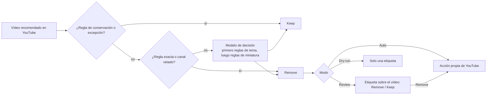

# Shoo

[English](../../README.md) · [简体中文](README.zh-CN.md) · **Español** · [Deutsch](README.de.md) · [Français](README.fr.md) · [日本語](README.ja.md)

La versión de referencia es el [README en inglés](../../README.md), y esta traducción puede ir por detrás de él.

Shoo es una extensión para Chrome y Firefox que quita las recomendaciones de YouTube que no quieres ver. Escribes reglas (Rules) en lenguaje normal, Shoo compara con ellas cada vídeo recomendado y, cuando uno coincide, usa las opciones propias de YouTube **Not interested** (No me interesa) o **Don't recommend channel** (No recomendar este canal), para que YouTube aprenda de ello. Cada eliminación indica la regla que la causó. Mientras sigues en la página, un clic la deshace, y Keep evita que Shoo vuelva a quitar ese vídeo.

Shoo no está afiliado a YouTube ni a Google, ni cuenta con su respaldo.

<p align="center">
  
</p>

| Tus reglas | Lo que hizo Shoo | Primer uso |
|---|---|---|
|  |  |  |

La captura superior y «Lo que hizo Shoo» se tomaron en una página de reproducción real de youtube.com. Todos los títulos, canales, visualizaciones, fechas, miniaturas y avatares se sustituyeron por otros inventados antes de cargar la página. Se bloquearon los vídeos, así que el reproductor muestra una imagen fija dibujada, y se ocultaron sus controles, su botón de reproducción y su marca de agua. Shoo funcionó en esa página sin cambios, con reglas de palabras clave. «Tus reglas» muestra reglas ficticias.

## Cómo funciona



- **Reglas.** Una regla de tema (Topic rule) es una sola frase en lenguaje normal, como «Vídeos de reacciones, en los que alguien mira otro contenido y reacciona». Una regla de miniatura (Thumbnail rule) describe lo que muestra una miniatura. Las reglas exactas (Exact rules) filtran por canal, por palabra clave o patrón en el título, por duración, por número de visualizaciones, o por Shorts o directos, en tu dispositivo y sin ningún modelo. Las reglas de conservación (Keep rules) protegen lo que siempre quieres ver, y pulsar Keep (Conservar) en un vídeo concreto añade una excepción (Exception). Una regla de eliminación se puede configurar para que no afecte a los canales a los que estás suscrito.
- **Modelo de decisión.** Las reglas de tema y de miniatura las juzga un modelo de decisión (Decision model), un modelo que responde a preguntas tipadas con probabilidades. Por defecto es `cloudflare/clef-flash` a través de la Decisions API de OpenRouter, con tu propia clave de OpenRouter. También puedes conectarte directamente a Cloudflare, TypeSafe o Perplexity con su clave, o ejecutar un modelo de decisión en tu ordenador con Ollama, llama.cpp o LM Studio. Settings (Ajustes) también admite un modelo de chat compatible con OpenAI, marcado como menos preciso. La intensidad del filtrado (Filtering strength: Cautious, Balanced o Eager, es decir, prudente, equilibrada o decidida) fija cuánta seguridad debe tener el modelo antes de que una regla elimine un vídeo.
- **Acciones propias de YouTube.** Shoo nunca oculta nada. Abre el menú del vídeo y pulsa Not interested, o Don't recommend channel en el caso de un canal vetado (Banned channel), y para eso necesitas haber iniciado sesión en YouTube.
- **Modos.** Review (Revisar) te pregunta primero sobre el propio vídeo. Auto (Automático) elimina en el acto. Dry-run (Simulación) solo etiqueta lo que haría.
- **Dónde.** En la página de inicio de YouTube, en la barra lateral de la página de reproducción y en la fila de Shorts, en el ordenador. Dos interruptores opcionales también piden a YouTube que muestre menos filas de Shorts y de juegos en la página de inicio.

Pagas al proveedor a través de tu propia clave. Con OpenRouter y clef-flash, una calibración con 10 reglas de tema midió unos 2,5 céntimos de dólar estadounidense por cada 1.000 vídeos, y menos con menos reglas. Shoo recuerda cada respuesta, así que un vídeo no se envía dos veces con las mismas reglas, y un límite diario restringe cuántos vídeos llegan al modelo en un día.

## Privacidad

Nada llega a un proveedor de modelos hasta que aceptas en la primera pantalla, y «Use Exact rules only» (Usar solo reglas exactas) no les envía absolutamente nada. La única solicitud que Shoo hace por su cuenta es a la propia YouTube: cuando una regla está configurada para no afectar a los canales a los que estás suscrito, Shoo lee tu página de suscripciones, con tu sesión iniciada, y guarda la lista en tu dispositivo.

Una vez que aceptas, Shoo envía de cada vídeo su título, el nombre del canal, la duración y el lugar de YouTube donde apareció, y la miniatura solo si tienes una regla de miniatura. Cada solicitud incluye además el texto de tus reglas de tema, de tus reglas de conservación de tema (Topic Keep rules) y de tus reglas de miniatura, y los títulos y nombres de canal de hasta 10 vídeos que conservaste. Todo ello va al proveedor de decisión (Decision provider) que elegiste: OpenRouter y el proveedor del modelo al que OpenRouter lo dirige (Cloudflare por defecto, TypeSafe u OpenAI como alternativas, o el proveedor de otro modelo que elijas), Cloudflare, TypeSafe o Perplexity directamente, o un modelo en tu ordenador, en cuyo caso nada sale del dispositivo. Si configuras un modelo de chat en Settings, es ese modelo el que recibe los mismos datos, sin las miniaturas.

Shoo nunca envía a un proveedor de modelos direcciones web, ID de vídeo, cookies, historial de reproducciones, comentarios ni datos de tu cuenta. No se envía nada al desarrollador y no hay analítica. La lista completa, el almacenamiento y la conservación de los datos están en la [política de privacidad](https://laoweek.github.io/shoo/release/privacy-policy.html). Preguntas: shoo@piran.xyz.

## Estado

Versión preliminar 0.2.0. Shoo todavía no está en la Chrome Web Store ni en Firefox Add-ons, así que instálalo desde el código fuente.

- Connect OpenRouter (inicio de sesión con OAuth) todavía no se ha probado en real. Puedes pegar una clave de OpenRouter en su lugar.
- Los proveedores de decisión directos se probaron con servidores sustitutos que siguen las reglas documentadas de cada proveedor, no con claves reales.

## Compilar e instalar desde el código fuente

Necesitas Node 24 (consulta [`.nvmrc`](../../.nvmrc)) y pnpm 11.9.0, que Corepack proporciona a partir de `package.json`.

```sh
corepack enable
pnpm install --frozen-lockfile
pnpm build            # Chrome, written to .output/chrome-mv3/
pnpm build:firefox    # Firefox, written to .output/firefox-mv3/
```

- **Chrome 120 o posterior:** abre `chrome://extensions`, activa Developer mode (Modo de desarrollador), elige **Load unpacked** (Cargar descomprimida) y selecciona `.output/chrome-mv3/`.
- **Firefox 140 o posterior (escritorio):** abre `about:debugging#/runtime/this-firefox`, elige **Load Temporary Add-on** (Cargar complemento temporal) y selecciona `.output/firefox-mv3/manifest.json`. Un complemento temporal se mantiene hasta que Firefox se reinicia. Las versiones estables de Firefox solo instalan de forma permanente complementos firmados.

`pnpm zip` y `pnpm zip:firefox` generan los paquetes para las tiendas en `.output/`. El comando de Firefox también genera el zip de código fuente a partir del cual los revisores de AMO recompilan la extensión, como se describe en [README-SOURCES.md](../../README-SOURCES.md).

## Compilaciones y versiones

La [CI](../../.github/workflows/ci.yml) ejecuta `pnpm check` en cada pull request y en cada push a `main`. Después, cada push a `main` compila los paquetes de distribución: el zip de Chrome, el zip de Firefox y el zip de código fuente de Firefox. Puedes descargarlos de los artefactos de la ejecución del workflow.

Para publicar una versión, ajusta `version` en `package.json`, haz commit y luego sube una etiqueta que coincida:

```sh
git tag v0.2.0
git push origin v0.2.0
```

La CI comprueba que la etiqueta coincide con `package.json` y publica una GitHub Release con los tres zips. La subida a la Chrome Web Store y a Firefox Add-ons es un paso manual. Los textos de las fichas y los formularios de las tiendas están en [docs/release/](../release/).

## Desarrollo

```sh
pnpm dev              # Chrome with the extension loaded, reloads on change
pnpm dev:firefox      # the same in Firefox
pnpm check            # what CI runs on every pull request and push
```

`pnpm check` ejecuta la comprobación de tipos de TypeScript, ESLint, las pruebas unitarias (Vitest), las compilaciones para ambos navegadores y los límites de tamaño (`scripts/check-size.mjs`). Las pruebas unitarias usan respuestas grabadas en `test/fixtures/` y nunca llaman a un modelo.

Las pruebas en vivo hay que activarlas expresamente y gastan un poco de crédito de OpenRouter (como mucho unos 0,01 $ por ejecución). Pon `OPENROUTER_API_KEY=...` en `.env.local`, que git ignora, y ejecuta `pnpm test:live`. No hagas nunca commit de una clave.

El sistema de calibración de [`scripts/calibration/`](../../scripts/calibration/README.md) mide lo bien que un modelo de decisión y una forma de solicitud juzgan un conjunto fijo de vídeos ficticios ya etiquetados. Sus resultados fijan los ajustes predefinidos de la intensidad del filtrado. Sus ejecuciones en vivo también gastan crédito, dentro de un límite que tú fijas.

## Documentación

| Lee | Para |
|---|---|
| [CONTEXT.md](../../CONTEXT.md) | Las palabras que se usan en el código, la documentación y la interfaz (Tile, Surface, Rule, Verdict, Exception…) |
| [docs/spec/](../spec/) | Los requisitos y las especificaciones de la arquitectura, el motor de decisión, la integración con YouTube, la interfaz y la publicación en tiendas. La fuente de verdad sobre el comportamiento |
| [docs/adr/](../adr/) | Por qué se tomaron las decisiones difíciles de revertir |
| [DESIGN.md](../../DESIGN.md) | El sistema visual, generado a partir de la compilación |
| [PRODUCT.md](../../PRODUCT.md) | Para quién es Shoo y qué promete |
| [AGENTS.md](../../AGENTS.md) | Normas de trabajo y trampas conocidas para colaboradores y agentes de programación |

## Contribuir

Consulta [CONTRIBUTING.md](../../CONTRIBUTING.md). Para informar de un problema de seguridad, consulta [SECURITY.md](../../SECURITY.md).

## Licencia

Apache-2.0. Consulta [LICENSE](../../LICENSE). El código, los iconos y las fuentes de terceros incluidos conservan sus propias licencias, que se enumeran en [THIRD_PARTY_NOTICES.md](../../THIRD_PARTY_NOTICES.md).
