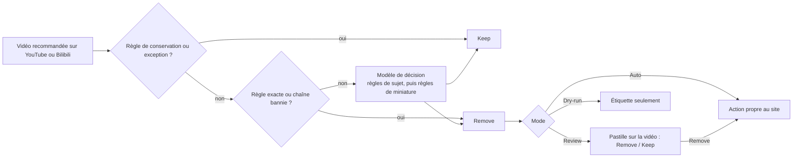

# Shoo

[English](../../README.md) · [简体中文](README.zh-CN.md) · [Español](README.es.md) · [Deutsch](README.de.md) · **Français** · [日本語](README.ja.md)

La version de référence est le [README en anglais](../../README.md), et cette traduction peut avoir du retard sur lui.

Shoo est une extension pour Chrome et Firefox qui fait le ménage dans les recommandations YouTube et Bilibili dont vous ne voulez pas. Vous écrivez des règles (Rules) en langage courant, Shoo compare chaque vidéo recommandée à ces règles et, quand l'une d'elles correspond, utilise les options du site lui-même, **Not interested** (Pas intéressé) ou **Don't recommend channel** (Ne pas recommander la chaîne), pour que le site en tienne compte. Chaque retrait indique la règle qui l'a provoqué. Tant que vous êtes encore sur la page, un clic l'annule, et Keep empêche Shoo de retirer à nouveau cette vidéo.

Shoo n'est ni affilié à YouTube, à Google ou à Bilibili, ni approuvé par eux.

<p align="center">
  
</p>

| Vos règles | Ce que Shoo a fait | Premier lancement |
|---|---|---|
|  |  |  |

La capture du haut et « Ce que Shoo a fait » ont été prises sur une vraie page de lecture de youtube.com. Tous les titres, chaînes, nombres de vues, dates, miniatures et avatars ont été remplacés par des équivalents inventés avant le chargement de la page. Les flux vidéo ont été bloqués, le lecteur affiche donc une image fixe dessinée, et ses commandes, son bouton de lecture et son filigrane ont été masqués. Shoo a fonctionné tel quel sur cette page, avec des règles par mot-clé. « Vos règles » montre des règles fictives.

## Fonctionnement



- **Règles.** Une règle de sujet (Topic rule) est une seule phrase en langage courant, par exemple « Les vidéos de réaction, où quelqu'un regarde d'autres contenus et y réagit ». Une règle de miniature (Thumbnail rule) décrit ce que montre une miniature. Les règles exactes (Exact rules) ciblent une chaîne, un mot-clé ou un motif dans le titre, une durée, un nombre de vues, les Shorts ou les directs, sur votre appareil et sans aucun modèle. Les règles de conservation (Keep rules) protègent ce que vous voulez toujours voir, et Keep (Garder) sur une vidéo précise ajoute une exception (Exception). Une règle de retrait peut être réglée pour ignorer les chaînes YouTube auxquelles vous êtes abonné.
- **Modèle de décision.** Les règles de sujet et de miniature sont évaluées par un modèle de décision (Decision model), c'est-à-dire un modèle qui répond à des questions typées par des probabilités. Par défaut, il s'agit de `cloudflare/clef-flash` via la Decisions API d'OpenRouter, avec votre propre clé OpenRouter. Vous pouvez aussi joindre directement Cloudflare, TypeSafe ou Perplexity avec leur clé, ou faire tourner un modèle de décision sur votre ordinateur avec Ollama, llama.cpp ou LM Studio. Settings (Paramètres) accepte aussi un modèle de chat compatible OpenAI, signalé comme moins précis. La force du filtrage (Filtering strength : Cautious, Balanced, Eager, soit prudent, équilibré, zélé) fixe le degré de certitude que doit avoir le modèle avant qu'une règle retire une vidéo.
- **Les actions propres au site.** Shoo ne masque jamais rien. Il ouvre le menu de la vidéo et clique sur Not interested, ou sur Don't recommend channel pour une chaîne bannie (Banned channel), ce qui demande d'être connecté à YouTube. Sur Bilibili, ce sont 内容不感兴趣 et 不想看此UP主.
- **Modes.** Review (Vérifier) vous pose d'abord la question sur la vidéo. Auto (Automatique) retire aussitôt. Dry-run (Essai à blanc) se contente d'étiqueter ce qu'il ferait.
- **Où.** Sur la page d'accueil de YouTube, dans la barre latérale de la page de lecture et dans la rangée de Shorts, ainsi que sur la page d'accueil de Bilibili, sur ordinateur. Vous pouvez désactiver l'un ou l'autre site dans Settings, Sites (Paramètres, Sites). Deux interrupteurs facultatifs demandent aussi à YouTube d'afficher moins de rangées de Shorts et de jeux sur la page d'accueil.
- **Les règles s'appliquent aux deux sites**, sauf si vous en limitez une à YouTube ou à Bilibili en l'ajoutant, ou plus tard depuis sa ligne. Une règle de chaîne créée depuis une vidéo (Always keep this channel, c'est-à-dire toujours garder cette chaîne, ou un bannissement proposé par une escalade (Escalation)) ne s'applique qu'au site de cette vidéo, et les règles sur les Shorts, les directs, les chaînes d'artiste (Artist channel) et le nombre de vues ne s'appliquent qu'à YouTube.

Vous payez le fournisseur via votre propre clé. Avec OpenRouter et clef-flash, un étalonnage avec 10 règles de sujet a mesuré environ 2,5 cents américains pour 1 000 vidéos, et moins avec moins de règles. Shoo mémorise chaque réponse, si bien qu'une vidéo n'est pas envoyée deux fois avec les mêmes règles, et un plafond quotidien limite le nombre de vidéos envoyées au modèle en une journée.

## Confidentialité

Rien ne part chez un fournisseur de modèle tant que vous n'avez pas donné votre accord sur le premier écran, et « Use Exact rules only » (Utiliser seulement les règles exactes) n'envoie rien du tout à aucun d'eux. En dehors des requêtes au modèle, Shoo ne contacte que les sites sur lesquels il fonctionne. Il charge les miniatures depuis les serveurs d'images de YouTube et de Bilibili, pour les vérifier avec une règle de miniature et pour les afficher dans les pages de Shoo. Quand une règle est réglée pour ignorer les chaînes auxquelles vous êtes abonné, Shoo lit votre page d'abonnements YouTube, connecté sous votre compte, et garde la liste sur votre appareil.

Une fois votre accord donné, Shoo envoie pour chaque vidéo son titre, le nom de la chaîne, sa durée et l'endroit de YouTube ou de Bilibili où elle est apparue, et la miniature seulement si vous avez une règle de miniature. Chaque requête contient aussi le texte de vos règles de sujet, de vos règles de conservation de sujet (Topic Keep rules) et de vos règles de miniature qui s'appliquent à ce site, ainsi que les titres et noms de chaîne de 10 vidéos au plus que vous avez gardées. Le tout part chez le fournisseur de décision (Decision provider) que vous avez choisi : OpenRouter et le fournisseur du modèle vers lequel OpenRouter redirige la requête (Cloudflare par défaut, TypeSafe ou OpenAI en solution de repli, ou le fournisseur d'un autre modèle que vous choisissez), Cloudflare, TypeSafe ou Perplexity en direct, ou un modèle sur votre ordinateur, auquel cas rien ne quitte l'appareil. Un modèle de chat configuré dans Settings reçoit alors les mêmes données à la place, sans les miniatures.

Shoo n'envoie jamais à un fournisseur de modèle d'adresses web, d'identifiants de vidéo ou de chaîne, de handles, de cookies, d'historique de visionnage, de commentaires, d'informations de compte ni la liste de vos abonnements. Une règle réglée pour ignorer les chaînes auxquelles vous êtes abonné envoie les vidéos de ces chaînes dans des requêtes à part, si bien qu'un fournisseur de modèle pourrait deviner auxquelles des chaînes qu'il voit vous êtes abonné. Rien ne part chez le développeur, et il n'y a aucun outil d'analyse d'audience. La liste complète, le stockage et la durée de conservation figurent dans la [politique de confidentialité](https://laoweek.github.io/shoo/release/privacy-policy.html). Questions : shoo@piran.xyz.

## État du projet

Préversion, version 0.2.0. Shoo n'est pas encore sur le Chrome Web Store ni sur Firefox Add-ons, il faut donc l'installer depuis les sources.

- Connect OpenRouter (connexion par OAuth) n'a pas encore été testé en conditions réelles. Vous pouvez coller une clé OpenRouter à la place.
- Les fournisseurs de décision en direct ont été testés contre des serveurs de substitution qui suivent les règles documentées de chaque fournisseur, et non avec de vraies clés.

## Compiler et installer depuis les sources

Il vous faut Node 24 (voir [`.nvmrc`](../../.nvmrc)) et pnpm 11.9.0, que Corepack fournit d'après `package.json`.

```sh
corepack enable
pnpm install --frozen-lockfile
pnpm build            # Chrome, written to .output/chrome-mv3/
pnpm build:firefox    # Firefox, written to .output/firefox-mv3/
```

- **Chrome 120 ou plus récent :** ouvrez `chrome://extensions`, activez Developer mode (Mode développeur), choisissez **Load unpacked** (Charger l'extension non empaquetée) et sélectionnez `.output/chrome-mv3/`.
- **Firefox 140 ou plus récent (ordinateur) :** ouvrez `about:debugging#/runtime/this-firefox`, choisissez **Load Temporary Add-on** (Charger un module temporaire) et sélectionnez `.output/firefox-mv3/manifest.json`. Un module temporaire reste en place jusqu'au redémarrage de Firefox. Les versions publiques de Firefox n'installent de façon permanente que des modules signés.

`pnpm zip` et `pnpm zip:firefox` écrivent les paquets pour les boutiques dans `.output/`. La commande Firefox écrit aussi le zip des sources à partir duquel les relecteurs d'AMO recompilent l'extension, comme décrit dans [README-SOURCES.md](../../README-SOURCES.md).

## Builds et versions

La [CI](../../.github/workflows/ci.yml) lance `pnpm check` à chaque pull request et à chaque push sur `main`. Chaque push sur `main` compile ensuite les paquets de distribution : le zip Chrome, le zip Firefox et le zip des sources Firefox. Vous pouvez les télécharger dans les artefacts de l'exécution du workflow. La même exécution recompile le zip Firefox à partir du zip des sources et échoue si un seul fichier diffère.

Pour publier une version, renseignez `version` dans `package.json`, faites un commit, puis poussez un tag correspondant :

```sh
git tag v0.2.0
git push origin v0.2.0
```

La CI vérifie que le tag correspond à `package.json` et publie une GitHub Release avec les trois zips. L'envoi sur le Chrome Web Store et sur Firefox Add-ons se fait à la main, avec les zips de cette GitHub Release, jamais avec une compilation locale. Les textes des fiches et les formulaires des boutiques se trouvent dans [docs/release/](../release/).

## Développement

```sh
pnpm dev              # Chrome with the extension loaded, reloads on change
pnpm dev:firefox      # the same in Firefox
pnpm check            # what CI runs on every pull request and push
```

`pnpm check` lance la vérification de types TypeScript, ESLint, les tests unitaires (Vitest), les builds pour les deux navigateurs et les budgets de taille (`scripts/check-size.mjs`). Les tests unitaires utilisent des réponses enregistrées dans `test/fixtures/` et n'appellent jamais de modèle.

Les tests en conditions réelles ne tournent que si vous les lancez explicitement et consomment un peu de crédit OpenRouter (au plus environ 0,01 $ par exécution). Mettez `OPENROUTER_API_KEY=...` dans `.env.local`, que git ignore, et lancez `pnpm test:live`. Ne commitez jamais de clé.

L'outil d'étalonnage dans [`scripts/calibration/`](../../scripts/calibration/README.md) mesure à quel point un modèle de décision et une forme de requête jugent bien un ensemble fixe de vidéos fictives étiquetées. Ses résultats fixent les préréglages de la force du filtrage. Ses exécutions réelles consomment aussi du crédit, dans la limite d'un plafond que vous fixez.

## Documentation

| À lire | Pour |
|---|---|
| [CONTEXT.md](../../CONTEXT.md) | Les termes employés dans le code, la documentation et l'interface (Tile, Surface, Rule, Verdict, Exception…) |
| [docs/spec/](../spec/) | Les exigences et les spécifications de l'architecture, du moteur de décision, de l'intégration YouTube et Bilibili, de l'interface et des publications sur les boutiques. La référence pour le comportement |
| [docs/adr/](../adr/) | Pourquoi les décisions difficilement réversibles ont été prises |
| [DESIGN.md](../../DESIGN.md) | Le système visuel, généré à partir du build |
| [PRODUCT.md](../../PRODUCT.md) | À qui s'adresse Shoo et ce qu'il promet |
| [AGENTS.md](../../AGENTS.md) | Règles de travail et pièges à connaître pour les contributeurs et les agents de code |

## Contribuer

Voir [CONTRIBUTING.md](../../CONTRIBUTING.md). Pour signaler un problème de sécurité, voir [SECURITY.md](../../SECURITY.md).

## Licence

Apache-2.0. Voir [LICENSE](../../LICENSE). Le code, les icônes et les polices tiers inclus conservent leurs propres licences, listées dans [THIRD_PARTY_NOTICES.md](../../THIRD_PARTY_NOTICES.md).
