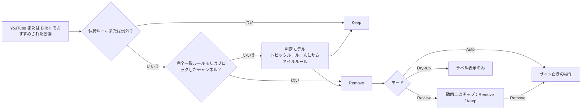

# Shoo

[English](../../README.md) · [简体中文](README.zh-CN.md) · [Español](README.es.md) · [Deutsch](README.de.md) · [Français](README.fr.md) · **日本語**

正式な内容は[英語版 README](../../README.md) です。この翻訳は英語版より古い場合があります。

Shoo は、見たくない YouTube と Bilibili のおすすめを片付ける Chrome と Firefox の拡張機能です。普段の言葉でルール（Rule）を書くと、Shoo がおすすめされた動画を一本ずつルールと照らし合わせ、当てはまったものにはそのサイト自身の **Not interested**（興味なし）か **Don't recommend channel**（チャンネルをおすすめに表示しない）を使います。そのためサイトもそこから学習します。削除のたびにどのルールが原因かが示されます。そのページにいる間はワンクリックで元に戻せ、Keep を押せば Shoo がその動画を再び削除することはありません。

Shoo は YouTube、Google、Bilibili とは提携しておらず、承認も受けていません。

<p align="center">
  
</p>

| あなたのルール | Shoo がしたこと | 初回起動 |
|---|---|---|
|  |  |  |

上のスクリーンショットと「Shoo がしたこと」は、youtube.com の実際の再生ページで撮影したものです。ページを読み込む前に、動画タイトル、チャンネル、再生回数、投稿時期、サムネイル、アイコンをすべて架空のものに差し替えました。動画の配信は止めたため、プレーヤーには描いた静止画が表示され、操作バー、再生ボタン、透かしは非表示にしました。Shoo はそのページでキーワードルールを使い、そのまま動作しています。「あなたのルール」は架空のルールです。

## しくみ



- **ルール。** トピックルール（Topic rule）は、「リアクション動画。誰かが他のコンテンツを見て反応するもの」のような、普段の言葉で書いた一文です。サムネイルルール（Thumbnail rule）は、サムネイルに写っている内容を説明します。完全一致ルール（Exact rule）は、チャンネル、タイトルのキーワードやパターン、長さ、再生回数、Shorts やライブ配信を、モデルを使わずにお使いの端末上で照合します。保持ルール（Keep rule）はいつも見たいものを守り、個別の動画で Keep（残す）を押すと例外（Exception）が追加されます。削除するルールは、登録済みの YouTube チャンネルを対象外にするよう設定できます。
- **判定モデル。** トピックルールとサムネイルルールは判定モデル（Decision model）が判断します。これは、型の決まった質問に確率で答えるモデルです。初期設定では、OpenRouter の Decisions API 経由の `cloudflare/clef-flash` を、あなた自身の OpenRouter キーで使います。代わりに、それぞれのキーで Cloudflare、TypeSafe、Perplexity に直接つなぐことも、Ollama、llama.cpp、LM Studio を使って自分のコンピューター上で判定モデルを動かすこともできます。Settings（設定）では OpenAI 互換のチャットモデルも指定できますが、精度が低いと表示されます。フィルタリングの強さ（Filtering strength：Cautious、Balanced、Eager、つまり慎重、標準、積極的）は、ルールが動画を削除するまでにモデルがどれだけ確信している必要があるかを決めます。
- **サイト自身の操作。** Shoo は何も隠しません。動画のメニューを開いて Not interested をクリックし、ブロックしたチャンネル（Banned channel）の場合は Don't recommend channel をクリックします。これには YouTube にログインしている必要があります。Bilibili では、これらは 内容不感兴趣 と 不想看此UP主 です。
- **モード。** Review（確認）は、まず動画の上であなたに確認します。Auto（自動）はすぐに削除します。Dry-run（試行）は、何をするかをラベルで示すだけです。
- **対象の場所。** パソコン版 YouTube のホーム、再生ページのサイドバー、Shorts の棚と、パソコン版 Bilibili のホームです。どちらのサイトも Settings の Sites（設定のサイト）でオフにできます。さらに 2 つのオプションのスイッチで、ホームに表示される Shorts とゲームの棚を減らすよう YouTube に伝えることもできます。
- **ルールは両方のサイトで働きます。** ただし、追加するとき、または後からその行で、YouTube か Bilibili のどちらかに限定することもできます。動画から作ったチャンネルのルール（Always keep this channel、つまりこのチャンネルを常に残す、またはエスカレーション（Escalation）が提案したブロック）は、その動画のサイトでだけ働きます。Shorts、ライブ、アーティストのチャンネル（Artist channel）、再生回数のルールは YouTube でだけ働きます。

料金は、あなた自身のキーを通じてプロバイダーに支払います。OpenRouter と clef-flash の組み合わせでは、10 個のトピックルールを使ったキャリブレーションで、動画 1,000 本あたり約 2.5 米セントでした。ルールが少なければさらに安くなります。Shoo は回答を一つずつ記憶するので、ルールが同じなら同じ動画を二度送ることはありません。また、1 日の上限によって、1 日にモデルへ送る動画の数が制限されます。

## プライバシー

最初の画面であなたが同意するまで、モデルプロバイダーには何も送られません。また、「Use Exact rules only」（完全一致ルールのみ使う）を選ぶと、モデルプロバイダーには一切送信されません。モデルへのリクエストのほかに、Shoo が通信するのは動作するサイトだけです。サムネイルルールで確認するためと、Shoo 自身のページに表示するために、YouTube と Bilibili の画像サーバーからサムネイルを読み込みます。登録済みのチャンネルを対象外にするよう設定したルールがあるとき、Shoo はあなたとしてログインした状態で YouTube の登録チャンネルのページを読み取り、その一覧をお使いの端末に保存します。

同意すると、Shoo は動画ごとに、タイトル、チャンネル名、長さ、YouTube または Bilibili のどこに表示されたかを送ります。サムネイルは、サムネイルルールがある場合にだけ送ります。各リクエストには、そのサイトで働くトピックルール、トピック保持ルール（Topic Keep rule）、サムネイルルールの本文と、あなたが残した動画のうち最大 10 本のタイトルとチャンネル名も含まれます。送り先は、あなたが選んだ判定プロバイダー（Decision provider）です。つまり、OpenRouter とその転送先のモデルプロバイダー（初期設定では Cloudflare、予備として TypeSafe か OpenAI、または別のモデルを選んだ場合はそのモデルのプロバイダー）、直接つないだ Cloudflare、TypeSafe、Perplexity、あるいはあなたのコンピューター上のモデルです。コンピューター上のモデルの場合、端末から外に出るものは何もありません。Settings でチャットモデルを設定した場合は、代わりにそのモデルが同じデータを受け取ります。ただしサムネイルは含まれません。

Shoo がモデルプロバイダーに Web アドレス、動画 ID、Cookie、視聴履歴、コメント、アカウント情報を送ることはありません。開発者には何も送られず、アクセス解析もありません。送信内容の完全な一覧、保存方法、保持期間は[プライバシーポリシー](https://laoweek.github.io/shoo/release/privacy-policy.html)にあります。お問い合わせ：shoo@piran.xyz

## 現状

プレリリースのバージョン 0.2.0 です。Shoo はまだ Chrome ウェブストアにも Firefox Add-ons にも公開されていないため、ソースからインストールしてください。

- Connect OpenRouter（OAuth によるサインイン）は、まだ実環境でテストしていません。代わりに OpenRouter キーを貼り付けることもできます。
- 直接つなぐ判定プロバイダーは、各プロバイダーのドキュメントに書かれた仕様に従う代替サーバーを相手にテストしたもので、実際のキーではテストしていません。

## ソースからビルドしてインストールする

Node 24（[`.nvmrc`](../../.nvmrc) を参照）と pnpm 11.9.0 が必要です。pnpm は Corepack が `package.json` をもとに用意します。

```sh
corepack enable
pnpm install --frozen-lockfile
pnpm build            # Chrome, written to .output/chrome-mv3/
pnpm build:firefox    # Firefox, written to .output/firefox-mv3/
```

- **Chrome 120 以降：** `chrome://extensions` を開き、Developer mode（デベロッパー モード）をオンにして、**Load unpacked**（パッケージ化されていない拡張機能を読み込む）を選び、`.output/chrome-mv3/` を選択します。
- **Firefox 140 以降（デスクトップ版）：** `about:debugging#/runtime/this-firefox` を開き、**Load Temporary Add-on**（一時的なアドオンを読み込む）を選び、`.output/firefox-mv3/manifest.json` を選択します。一時的なアドオンは Firefox を再起動するまで残ります。Firefox のリリース版で恒久的にインストールできるのは署名済みのアドオンだけです。

`pnpm zip` と `pnpm zip:firefox` は、ストア用のパッケージを `.output/` に書き出します。Firefox のコマンドは、AMO の審査担当者が再ビルドに使うソースの zip も書き出します。詳しくは [README-SOURCES.md](../../README-SOURCES.md) を参照してください。

## ビルドとリリース

[CI](../../.github/workflows/ci.yml) は、プルリクエストと `main` へのプッシュのたびに `pnpm check` を実行します。さらに `main` へのプッシュのたびに、配布用パッケージとして Chrome の zip、Firefox の zip、Firefox のソースの zip をビルドします。これらはワークフロー実行の artifacts からダウンロードできます。

リリースするには、`package.json` の `version` を設定してコミットし、それに合ったタグをプッシュします。

```sh
git tag v0.2.0
git push origin v0.2.0
```

CI はタグが `package.json` と一致するかを確認し、3 つの zip を添えた GitHub Release を公開します。Chrome ウェブストアと Firefox Add-ons へのアップロードは手作業です。ストア掲載文とストアのフォームは [docs/release/](../release/) にあります。

## 開発

```sh
pnpm dev              # Chrome with the extension loaded, reloads on change
pnpm dev:firefox      # the same in Firefox
pnpm check            # what CI runs on every pull request and push
```

`pnpm check` は、TypeScript の型チェック、ESLint、ユニットテスト（Vitest）、両ブラウザ向けのビルド、サイズ予算のチェック（`scripts/check-size.mjs`）を実行します。ユニットテストは `test/fixtures/` に記録したレスポンスを使い、モデルを呼び出すことはありません。

ライブテストは明示的に有効にしたときだけ動き、OpenRouter のクレジットを少し消費します（1 回あたり最大で約 0.01 ドル）。git の管理対象外である `.env.local` に `OPENROUTER_API_KEY=...` を書き、`pnpm test:live` を実行してください。キーは絶対にコミットしないでください。

[`scripts/calibration/`](../../scripts/calibration/README.md) にあるキャリブレーション用ツールは、判定モデルとリクエストの形式が、ラベル付きの架空の動画の固定セットをどれだけ正しく判定できるかを測ります。その結果をもとに、フィルタリングの強さのプリセットが決まります。ライブでの実行もクレジットを消費しますが、あなたが決めた上限の範囲内に収まります。

## ドキュメント

| 読むもの | 内容 |
|---|---|
| [CONTEXT.md](../../CONTEXT.md) | コード、ドキュメント、UI で使う用語（Tile、Surface、Rule、Verdict、Exception…） |
| [docs/spec/](../spec/) | 要件と、アーキテクチャ、判定エンジン、YouTube および Bilibili との連携、UI、ストアへのリリースの仕様。動作についての正となる情報源 |
| [docs/adr/](../adr/) | 後から覆しにくい決定が、なぜそうなったのか |
| [DESIGN.md](../../DESIGN.md) | ビルドから生成したビジュアルシステム |
| [PRODUCT.md](../../PRODUCT.md) | Shoo が誰のためのもので、何を約束するのか |
| [AGENTS.md](../../AGENTS.md) | コントリビューターとコーディングエージェント向けの作業ルールと注意点 |

## コントリビュート

[CONTRIBUTING.md](../../CONTRIBUTING.md) を参照してください。セキュリティ上の問題を報告するには、[SECURITY.md](../../SECURITY.md) を参照してください。

## ライセンス

Apache-2.0。[LICENSE](../../LICENSE) を参照してください。同梱しているサードパーティのコード、アイコン、フォントには、それぞれのライセンスが適用されます。一覧は [THIRD_PARTY_NOTICES.md](../../THIRD_PARTY_NOTICES.md) にあります。
