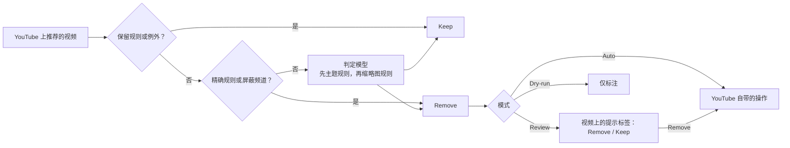

# Shoo

[English](../../README.md) · **简体中文** · [Español](README.es.md) · [Deutsch](README.de.md) · [Français](README.fr.md) · [日本語](README.ja.md)

以[英文版 README](../../README.md) 为准，本译文可能滞后于英文版。

Shoo 是一款 Chrome 和 Firefox 扩展，用来清除你不想看的 YouTube 推荐。你用日常语言写下规则（Rule），Shoo 会拿每个推荐视频去对照这些规则，一旦命中，就使用 YouTube 自带的 **Not interested**（不感兴趣）或 **Don't recommend channel**（不推荐此频道），让 YouTube 从中学习。每一次移除都会写明是哪条规则导致的。只要你还在该页面上，一键即可撤销，点 Keep 则 Shoo 不会再移除这个视频。

Shoo 与 YouTube 或 Google 没有任何关联，也未获得其认可。

<p align="center">
  
</p>

| 你的规则 | Shoo 做了什么 | 首次运行 |
|---|---|---|
|  |  |  |

顶部截图和“Shoo 做了什么”是在 youtube.com 的真实播放页上拍摄的。页面加载前，所有视频标题、频道、播放量、发布时间、缩略图和头像都换成了虚构内容。视频流被拦截，因此播放器显示的是一张绘制的静态图，其控制栏、播放按钮和水印也被隐藏。Shoo 在该页面上使用关键词规则照常运行。“你的规则”中的规则为虚构。

## 工作原理



- **规则。** 主题规则（Topic rule）是一句日常语言，例如“反应视频，即有人观看其他内容并做出反应”。缩略图规则（Thumbnail rule）描述缩略图里显示的内容。精确规则（Exact rule）在你的设备上按频道、标题关键词或模式、时长、观看次数、Shorts 或直播来匹配，不需要任何模型。保留规则（Keep rule）保护你始终想看的内容，而对单个视频点 Keep（保留）会添加一个例外（Exception）。移除类规则可以设置为跳过你已订阅的频道。
- **判定模型。** 主题规则和缩略图规则由判定模型（Decision model）来判断，这是一种用概率回答类型化问题的模型。默认使用 OpenRouter 的 Decisions API 上的 `cloudflare/clef-flash`，使用你自己的 OpenRouter 密钥。你也可以用各自的密钥直接连接 Cloudflare、TypeSafe 或 Perplexity，或者用 Ollama、llama.cpp 或 LM Studio 在自己的电脑上运行判定模型。Settings（设置）中也可以填入兼容 OpenAI 的聊天模型，它会被标为准确度较低。过滤强度（Filtering strength，可选 Cautious、Balanced、Eager，即谨慎、平衡、积极）决定模型要有多大把握，规则才会移除一个视频。
- **YouTube 自带的操作。** Shoo 从不隐藏任何内容。它会打开视频的菜单并点击 Not interested，对于屏蔽频道（Banned channel）则点击 Don't recommend channel，这需要你已登录 YouTube。
- **模式。** Review（审核）会先在视频上询问你。Auto（自动）会立即移除。Dry-run（试运行）只标注它会怎么做。
- **适用位置。** 桌面版 YouTube 的首页、观看页侧栏和 Shorts 栏。另有两个可选开关，可以让 YouTube 在首页少显示 Shorts 栏和游戏栏。

费用由你通过自己的密钥付给服务商。使用 OpenRouter 和 clef-flash 时，用 10 条主题规则做校准测得的费用约为每 1,000 个视频 2.5 美分，规则越少费用越低。Shoo 会记住每一次回答，所以在规则不变的情况下同一个视频不会被发送两次，另有每日上限限制每天最多有多少视频发送给模型。

## 隐私

在你于第一个页面上同意之前，任何数据都不会发送给模型服务商，而选择 “Use Exact rules only”（仅使用精确规则）则完全不会向它们发送任何内容。Shoo 唯一主动发出的请求是发给 YouTube 本身的：当某条规则设置为跳过你已订阅的频道时，Shoo 会以你的登录身份读取你的订阅页面，并把订阅列表保存在你的设备上。

在你同意之后，Shoo 会为每个视频发送它的标题、频道名称、时长以及它出现在 YouTube 上的位置，只有当你设有缩略图规则时才会发送缩略图。每次请求还会附带你的主题规则、主题保留规则（Topic Keep rule）和缩略图规则的文字，以及最多 10 个你保留过的视频的标题和频道名称。这些数据会发送给你选择的判定服务商（Decision provider）：OpenRouter 及其转发到的模型服务商（默认是 Cloudflare，备用为 TypeSafe 或 OpenAI，或者你选择的其他模型的服务商），直接连接的 Cloudflare、TypeSafe 或 Perplexity，或者你电脑上的模型，此时任何数据都不会离开设备。如果你在 Settings 中设置了聊天模型，则改由它接收同样的数据，但不包括缩略图。

Shoo 从不向模型服务商发送网址、视频 ID、Cookie、观看记录、评论或账号信息。没有任何数据发送给开发者，也没有任何分析统计。完整清单以及存储和保留方式见[隐私政策](https://laoweek.github.io/shoo/release/privacy-policy.html)。如有疑问请联系：shoo@piran.xyz。

## 状态

预发布版本，版本号 0.2.0。Shoo 尚未上架 Chrome 应用商店或 Firefox 附加组件网站，因此请从源码安装。

- Connect OpenRouter（通过 OAuth 登录）尚未经过真实环境测试。你可以改为粘贴 OpenRouter 密钥。
- 直接连接的判定服务商是用模拟服务器测试的，这些服务器遵循各服务商公开文档中的规则，并未使用真实密钥测试。

## 从源码构建和安装

你需要 Node 24（见 [`.nvmrc`](../../.nvmrc)）和 pnpm 11.9.0，后者由 Corepack 根据 `package.json` 提供。

```sh
corepack enable
pnpm install --frozen-lockfile
pnpm build            # Chrome, written to .output/chrome-mv3/
pnpm build:firefox    # Firefox, written to .output/firefox-mv3/
```

- **Chrome 120 或更高版本：** 打开 `chrome://extensions`，开启 Developer mode（开发者模式），选择 **Load unpacked**（加载已解压的扩展程序），然后选中 `.output/chrome-mv3/`。
- **Firefox 140 或更高版本（桌面版）：** 打开 `about:debugging#/runtime/this-firefox`，选择 **Load Temporary Add-on**（临时载入附加组件），然后选中 `.output/firefox-mv3/manifest.json`。临时附加组件会一直保留到 Firefox 重启。Firefox 的正式版只会永久安装已签名的附加组件。

`pnpm zip` 和 `pnpm zip:firefox` 会把商店安装包写入 `.output/`。Firefox 的命令还会写出供 AMO 审核人员重新构建用的源码 zip，详见 [README-SOURCES.md](../../README-SOURCES.md)。

## 构建与发布

[CI](../../.github/workflows/ci.yml) 会在每个拉取请求和每次推送到 `main` 时运行 `pnpm check`。之后，每次推送到 `main` 都会构建分发包：Chrome zip、Firefox zip 和 Firefox 源码 zip。可以从该工作流运行的 artifacts 中下载。

发布时，先在 `package.json` 中设置 `version` 并提交，然后推送一个对应的标签：

```sh
git tag v0.2.0
git push origin v0.2.0
```

CI 会检查标签是否与 `package.json` 一致，并发布一个附带这三个 zip 的 GitHub Release。上传到 Chrome 应用商店和 Firefox 附加组件网站需要手动完成。商店介绍文案和商店表单见 [docs/release/](../release/)。

## 开发

```sh
pnpm dev              # Chrome with the extension loaded, reloads on change
pnpm dev:firefox      # the same in Firefox
pnpm check            # what CI runs on every pull request and push
```

`pnpm check` 会运行 TypeScript 类型检查、ESLint、单元测试（Vitest）、两种浏览器的构建以及体积预算检查（`scripts/check-size.mjs`）。单元测试使用 `test/fixtures/` 中录制好的响应，从不调用模型。

在线测试需要主动开启，会花费少量 OpenRouter 额度（每次运行最多约 0.01 美元）。把 `OPENROUTER_API_KEY=...` 写入 `.env.local`（该文件已被 git 忽略），然后运行 `pnpm test:live`。切勿提交密钥。

[`scripts/calibration/`](../../scripts/calibration/README.md) 中的校准工具用来衡量一个判定模型和一种请求形式在一组固定的、已标注的虚构视频上判断得有多准。它的结果决定了过滤强度的各个预设。它的在线运行同样会花费额度，但不会超过你设定的上限。

## 文档

| 阅读 | 用途 |
|---|---|
| [CONTEXT.md](../../CONTEXT.md) | 代码、文档和界面中使用的术语（Tile、Surface、Rule、Verdict、Exception…） |
| [docs/spec/](../spec/) | 需求文档，以及架构、判定引擎、YouTube 集成、界面和商店发布的规格说明。行为以此为准 |
| [docs/adr/](../adr/) | 那些难以撤回的决定是出于什么原因做出的 |
| [DESIGN.md](../../DESIGN.md) | 视觉体系，根据构建结果生成 |
| [PRODUCT.md](../../PRODUCT.md) | Shoo 面向谁，以及它做出哪些承诺 |
| [AGENTS.md](../../AGENTS.md) | 面向贡献者和编码智能体的工作规则与注意事项 |

## 参与贡献

见 [CONTRIBUTING.md](../../CONTRIBUTING.md)。如需报告安全问题，请见 [SECURITY.md](../../SECURITY.md)。

## 许可证

Apache-2.0。见 [LICENSE](../../LICENSE)。随附的第三方代码、图标和字体保留各自的许可证，列在 [THIRD_PARTY_NOTICES.md](../../THIRD_PARTY_NOTICES.md) 中。
