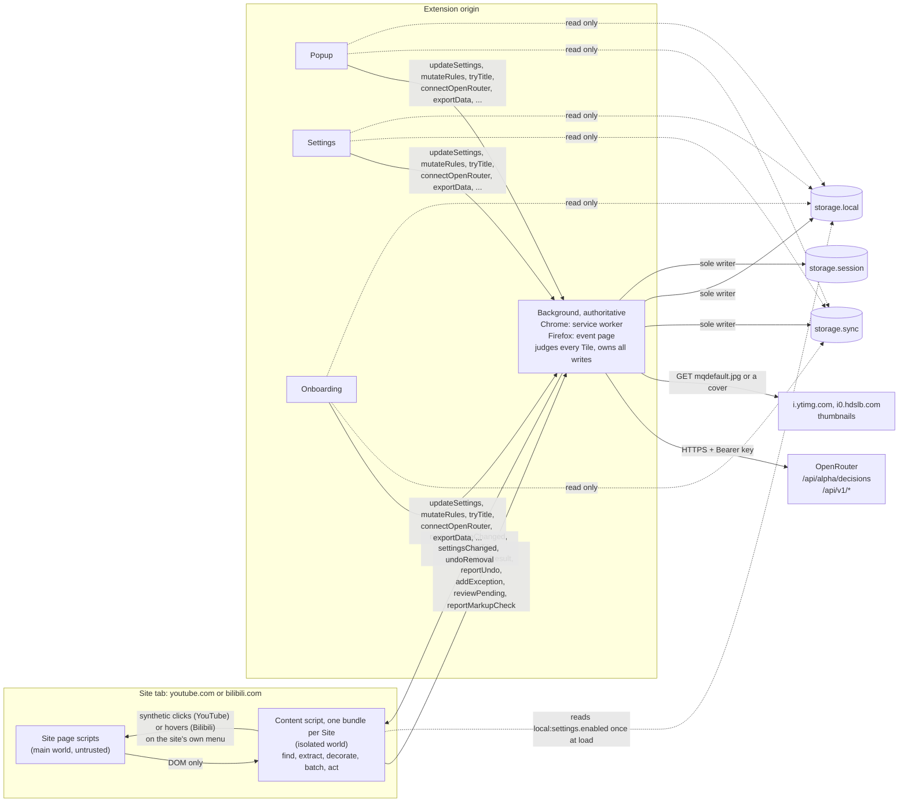
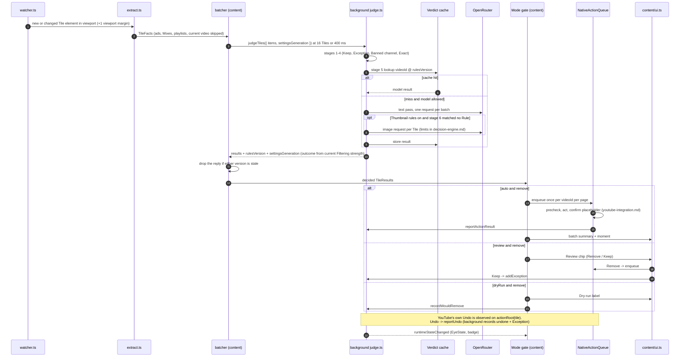

# Shoo architecture

How the extension is put together. Read with `docs/spec/requirements.md` (what), `docs/spec/decision-engine.md` (OpenRouter requests), `docs/spec/youtube-integration.md` (YouTube DOM and Native actions, and the content engine every Site shares), `docs/spec/bilibili-integration.md` (Bilibili DOM and Native actions), `docs/spec/ui-design.md` (look and behaviour) and `CONTEXT.md` (names). `REQ-…` ids point into `requirements.md`. Why Sites are adapters and both are on from install: ADR 0011. Which Rules work on which Site: ADR 0012.

This file is the single source of truth for: pipeline ownership, domain types, the Messages contract, the RuntimeState machine and failure counters, storage layout and budgets, `rulesVersion`, ChannelKey, ActivityEvent, key isolation, bundle budgets, mid-flight changes and Mode transitions, and decoration state. Other specs link here instead of restating these.

It links out for:
- Network policy (timeouts, concurrency, retries, fallback triggers), request and response shapes, and the Verdict cache record shape: `decision-engine.md`.
- NativeActionQueue steps and timings, mount anchors, `actionRoot`, focus safety: `youtube-integration.md`, and for Bilibili's Surfaces, menu and placeholder `bilibili-integration.md`.
- Exact rule semantics and the data-sent list: `requirements.md` (sections "Rules" and "Data sent and consent").

## 1. Context



| Boundary | Allowed | Never |
|---|---|---|
| Site page ↔ content | DOM reads, `MutationObserver`, synthetic `click()` on YouTube's menu button, menu item and Undo button, synthetic `mouseenter` and `mouseleave` on Bilibili's menu button and `click()` on its menu item and Undo | `window.postMessage` listeners, MAIN-world scripts (ADR 0005), reading the site's page data (Polymer `.data`, Vue state) |
| Content ↔ background | Messages in Section 6. Payloads are `TileFacts`, `TileResult`, action reports | API key, raw HTML, URLs (except a Bilibili cover's path, checked against `BILIBILI_COVER_PATH`), cookies, compiled Rules |
| Content ↔ storage | One read of `local:settings` at load to learn `enabled` | Any write. Subscribing to `storage.onChanged`. Reading `sync:*` or `local:secret:*` |
| Pages ↔ storage | Reads for display | Any write (every mutation goes through the background, Section 8) |
| Background ↔ OpenRouter | The data in REQ-PRIV-1 | Video IDs, URLs, channel IDs |
| Background ↔ i.ytimg.com | `GET https://i.ytimg.com/vi/<id>/mqdefault.jpg` with `credentials: 'omit'` | Cookies, credentials |
| Background ↔ youtube.com | `GET https://www.youtube.com/feed/channels` with the user's YouTube cookies, only while a Rule skips Subscribed channels (REQ-RULE-14, `youtube-integration.md` Section 9) | Any other request, following a redirect, storing the page |
| Background ↔ i0.hdslb.com | `GET https://i0.hdslb.com/bfs/archive/<hash>.jpg@320w_180h_1c.jpg` with `credentials: 'omit'` and no referrer, only with Bilibili turned on | Cookies, credentials |

## 2. Source layout

WXT with `srcDir: 'src'`. Each Site's content script is one bundle (ADR 0006, ADR 0011).

```
src/
  entrypoints/
    background/index.ts      # entrypoint: registers every listener, builds the background from app.ts
    background/*.ts          # router, judge pipeline, sole storage writer, alarms, action icon, commands
                             #   (app, router, guards, services, runtime-state, platform)
    background/handlers/*.ts # routes: judging, actions, escalation, connection, settings, user-ban, shelves
    youtube.content.ts       # YouTube's content script (manifest): startContent(ctx, youtube)
    bilibili.content.ts      # Bilibili's content script (manifest, ADR 0011): startContent(ctx, bilibili)
    popup/ (index.html, main.tsx, App.tsx)
    options/ (index.html, main.tsx, App.tsx, sections/*)
    onboarding/ (index.html, main.tsx)
  core/                      # pure TS, no browser APIs, 100% unit tested
    rules.ts                 # Rule types, refs (R/K numbers), colours, priority pipeline stages 1-4
    exact.ts                 # Exact rule matchers, compiled per exactVersion (semantics: requirements.md "Rules")
    regex.ts                 # strict-subset regex validator (Section 13)
    verdict.ts               # Verdict, removeCutoff(strength)
    escalation.ts            # Escalation trigger and re-suggest rule
    budget.ts                # state token budget (~2,000 tokens): Rules + up to 10 Exceptions
    ids.ts                   # rulesVersion, exactVersion, question ids t01..t16
    runtime.ts               # RuntimeState reasons, precedence, allowed stages (Section 7)
    channel.ts               # channelKey() and channel matching (Section 10)
    providers.ts             # Decision providers reached directly: address, model, images, envelope (decision-engine.md §12)
    sites.ts                 # SiteId, Surface → Site, video ID shapes, Site origins, thumbnail URLs
    count.ts                 # parseCount, formatCount: view counts typed with k, m or b (REQ-RULE-13)
    subscriptions.ts         # parse the Subscribed channels page, subscribedMatcher (REQ-RULE-14)
  content/                   # the content engine, the same for every Site (content only)
    start.ts boot.ts         # read enabled, getRuntimeState, start the pipeline for a Site
    pipeline.ts batcher.ts   # Surface detect, batching, Mode gate, Undo ownership, Shelf dismissal and user bans through optional Site hooks
    watcher.ts actions.ts mount.ts  # observers, NativeActionQueue (Tile and Shelf targets) and focus safety, chip and annotation hosts
    ui.ts notices.ts         # in-page Preact UI adapter, mountUi() runs only on first need
  sites/                     # what each Site knows (content only)
    site.ts                  # the contract: SurfaceDef, SiteMenu, SitePlaceholder, Site, and the optional shelves and watchUserBans only YouTube has
    youtube/                 # surfaces.ts extract.ts menu.ts user-ban.ts shelves.ts theme.ts, see youtube-integration.md
    bilibili/                # surfaces.ts extract.ts menu.ts theme.ts, see bilibili-integration.md
  engine/                    # background only
    decisions.ts             # Decisions API client, request builders, REQUEST_SHAPE_VERSION, TEXT_FRAMING
    chat.ts                  # custom OpenAI-compatible endpoint client (chat model, Settings only)
    thumbnails.ts            # fetch i.ytimg.com mqdefault, base64 data URL
    judge.ts                 # full pipeline stages 1-7 (Section 5)
    oauth.ts                 # OpenRouter PKCE via identity.launchWebAuthFlow
    models.ts                # live model catalogue
  store/
    schema.ts                # versioned schema, migrations, DEFAULT_SETTINGS
    sync.ts                  # Rules, Keep rules, Banned channels, synced Exceptions (Section 8)
    local.ts                 # settings, Verdict cache, Activity, counters, stats, runtime, archive
    secret.ts                # API key accessors, imported only by engine/ and the background router
    read.ts                  # read-only helpers for pages, readEnabled() for content
    writer.ts                # the serialized mutation queue (background only)
  messaging/protocol.ts      # Section 6, implemented with @webext-core/messaging
  ui/                        # Preact components and tokens (ui-design.md)
  i18n/                      # @wxt-dev/i18n catalogue, keys area.component.message
test/fixtures/youtube/       # real captured fixtures
test/fixtures/bilibili/      # captured structural skeletons
test/fixtures/openrouter/    # recorded Decisions responses (decision-engine.md)
```

## 3. Domain types

Binding names. `core/` owns them and every other layer imports from there.

```ts
type SiteId = 'youtube' | 'bilibili';  // core/sites.ts. A video ID's shape tells its Site
type SurfaceId = 'home' | 'watchSidebar' | 'shortsShelf' | 'search' | 'channel' | 'endScreen'   // YouTube
  | 'bilibiliHome' | 'bilibiliVideoSidebar';                                                   // Bilibili (SURFACE_SITE)
type RuleKind = 'topic' | 'thumbnail' | 'channel' | 'keyword' | 'pattern' | 'regex' | 'duration' | 'views' | 'short' | 'live' | 'membersOnly' | 'artistChannel';
// 'membersOnly' and the upcoming half of 'live' stay hidden in the UI until fixtures exist (requirements.md "Rules").
type Polarity = 'remove' | 'keep';     // thumbnail + keep is invalid in v1, artistChannel + remove is invalid ('artistChannelRemove')
type NativeAction = 'notInterested' | 'dontRecommendChannel';
type Mode = 'auto' | 'review' | 'dryRun';
type EyeState = 'watching' | 'judging' | 'review' | 'paused' | 'error';

interface Rule {
  id: string;                 // random UUID, stable across devices. Stats and Activity key on this
  ref: string;                // 'R12' or 'K3'. Changes only on a sync or import collision (REQ-RULE-6)
  polarity: Polarity;
  kind: RuleKind;
  text: string;               // the user's words, never rewritten (REQ-RULE-7)
  name?: string;              // Rule name, trimmed, at most 40 characters, absent when blank. Never sent to a model, not in rulesVersion (REQ-RULE-11)
  params?: { channelName?: string; channelId?: string; handle?: string; minSeconds?: number; maxSeconds?: number; minViews?: number; maxViews?: number };
  site?: SiteId;              // a Site-only rule works on this Site only, unset for every Site (ADR 0012). Short, Live, Members-only, Artist channel and views Rules work on YouTube whatever is stored (ruleSite)
  colour?: `c${1|2|3|4|5|6|7|8|9|10}`;  // remove Rules only (ui-design.md "Rule colour codes")
  skipSubscribed?: boolean;   // remove Rules only, stored only when true: never removes a Tile from a Subscribed channel (REQ-RULE-14)
  enabled: boolean;
  origin: 'user' | 'escalation' | 'starter';
  createdAt: number;
  updatedAt: number;
  deletedAt?: number;         // tombstone for sync merge, purged after 30 days
}
// Banned channel = Rule { kind: 'channel', polarity: 'remove' } -> nativeAction 'dontRecommendChannel'

interface TileFacts {          // produced by the Site's extract.ts (src/sites/<site>/), sent in judgeTiles
  videoId: string;             // YouTube: 11 characters. Bilibili: 'BV' + 10
  surface: SurfaceId;          // per item, a batch may mix Surfaces
  title: string;
  channelName?: string;
  channelHandle?: string;
  channelId?: string;
  durationSec?: number;
  viewCount?: number;          // set only when YouTube shows it in English, never on live Tiles (REQ-RULE-13). Never sent to a model
  isShort: boolean;
  isLive: boolean;
  isUpcoming: boolean;
  isMembersOnly: boolean;
  isArtistChannel?: boolean;   // set only when true: the channel shows the Official Artist Channel badge. Never sent to a model
  cover?: string;              // Bilibili only: the cover's path on i0.hdslb.com (BILIBILI_COVER_PATH), for the thumbnail pass. Never sent to a model
}

type VerdictSource = 'keepRule' | 'exception' | 'exact' | 'model' | 'modelThumbnail';
interface Verdict {
  videoId: string;
  outcome: 'keep' | 'remove';
  ruleId?: string;
  ruleRef?: string;            // display only
  probability?: number;        // P(remove) for model Verdicts
  source: VerdictSource;
  nativeAction?: NativeAction; // set when outcome is 'remove'
  rescuedFrom?: string;        // Rescue: ruleId of the remove Rule or Banned channel a Keep rule beat. Keep Verdicts with source 'keepRule' only (decision-engine.md Section 1.1)
  rulesVersion: string;
  at: number;
}

interface Exception { videoId: string; title: string; channelName?: string; channelKey?: string; ruleId?: string; at: number; }

type ActivityKind = 'removed' | 'kept' | 'keptByRule' | 'wouldRemove' | 'failed' | 'escalated' | 'undone' | 'renumbered' | 'banned' | 'shelfDismissed';
type ActionStep = 'openMenu' | 'findItem' | 'clickItem' | 'confirmPlaceholder' | 'undo';
interface ActivityEvent {
  id: string;
  kind: ActivityKind;
  at: number;
  videoId?: string;
  title?: string;              // truncated to 120 chars
  channelName?: string;
  channelKey?: string;
  surface?: SurfaceId;
  ruleId?: string;
  source?: VerdictSource;
  p?: number;
  mode?: Mode;
  batchId?: string;            // groups one batch summary ("Review this batch")
  nativeAction?: NativeAction;
  step?: ActionStep;           // failures only
  selectorVersion?: string;    // failures only
  detail?: string;             // e.g. 'R7 -> R9' for renumbered
  shelf?: ShelfId;             // shelfDismissed only: 'shorts' | 'games'
  seenAt?: number;             // set when the row was visible for 1 s (lit until seen). keptByRule events are written with seenAt = at
  cover?: string;              // Bilibili only: the cover path, so Activity shows a thumbnail
  site?: SiteId;               // only on events about no video (escalated): the channel's Site, so Activity can name and filter it
}
```

## 4. Module responsibilities and dependency rules

| Module | Runs in | Owns | May import |
|---|---|---|---|
| `core/` | anywhere | pipeline stages 1-4, Exact matching, regex validation, cutoffs, Escalation math, budget, hashing, RuntimeState, ChannelKey, Sites and their Surfaces, view counts, Subscribed channel matching | nothing outside `core/` |
| `sites/` | content only | per Site: Surface registry, extraction, menu, placeholder and Undo, theme, and YouTube's Shelf dismissal and user-ban watcher (the contract in `sites/site.ts`) | `core/` |
| `content/` | content only | the engine for any Site: pipeline, observers, NativeActionQueue and focus safety, hosts, in-page UI adapter | `core/`, `sites/`, `messaging/`, `store/read.ts`, `ui/` |
| `engine/` | background only | Decisions client for OpenRouter and direct Decision providers, custom endpoint client, thumbnails, `judge.ts`, fallback chain, OAuth, model list | `core/`, `store/` |
| `store/` | background (all), pages (`read.ts` only), content (`readEnabled()` only) | schema, migrations, sync packing and merge, local keys, the mutation queue | `core/` |
| `store/secret.ts` | background only | API key read and write | `core/` types |
| `messaging/` | all | typed protocol | `core/` types |
| `ui/` | popup, options, onboarding, `content/ui.ts` | components, tokens, `Eyes` | `core/`, `i18n/` |
| `i18n/` | all UI | catalogue, `t()` | nothing |

Rules enforced by lint and tests:
1. `core/` uses no `browser.*`, `document` or `fetch`. It runs under plain Node in tests.
2. `sites/` is imported only from `content/` and the content entrypoints (`entrypoints/*.content.ts`), `content/` only from the content entrypoints. A Site imports nothing from `content/`. `engine/` and `store/writer.ts` only from `entrypoints/background/` (the entrypoint `background/index.ts` and the modules beside it).
3. **Key isolation.** `store/secret.ts` is imported only by `engine/` and the background (`entrypoints/background/`). ESLint's `no-restricted-imports` rule (`eslint.config.js`) rejects the import anywhere else in `src/` except `store/` itself and test files, and `scripts/check-size.mjs` (`pnpm size`) fails when a built content-script bundle contains `secret:`, `openrouterKey` or `customKey`. `pnpm check` runs both. Content scripts can technically read `storage.local` in both browsers, so this structure is the boundary.
4. Content calls `mountUi()` only when the first chip, label, summary or notice is needed. Nothing in `ui/` runs at load.
5. Only `content/actions.ts` clicks or hovers anything on a Site's page, through the Site's `SiteMenu` and `SitePlaceholder`.

## 5. Judging pipeline and Tile lifecycle

### Ownership

The background is authoritative for every judging stage. Content finds, extracts, decorates, batches and acts. It holds no Rules and makes no decisions of its own.

| Stage | What | Runs in | Notes |
|---|---|---|---|
| 1 | Keep rule (exact kinds) | background `core/rules.ts` | ends the pipeline with Keep |
| 2 | Exception | background | checks synced Exceptions, the local archive, and the tab's session Exceptions in private windows |
| 3 | Banned channel | background | remove with `dontRecommendChannel` |
| 4 | Other Exact rules | background, matchers compiled per `exactVersion` | remove with `notInterested` |
| 5 | Verdict cache | background | keyed `videoId` + `cacheVersion`, built on the `rulesVersion` of the Rules that work on the Tile's Site (Section 9), record shape in `decision-engine.md` |
| 6 | Topic rules and Topic Keep rules (text pass) | background `engine/` | Topic Keep beats every remove |
| 7 | Thumbnail rules | background `engine/` | only when stage 6 matched no Rule at all (no remove ref, no keep ref) |

- **Rules per Site.** A batch comes from one Site (the router rejects a `judgeTiles` with another Site's Tiles), and every stage sees only the Rules that work there (`rulesOn` in `core/rules.ts`, ADR 0012). Exact matchers are compiled per Site. The text pass leaves out kept examples whose Rule works only on another Site (`exampleOn`).
- **Exact remove vs Topic Keep.** When stage 3 or 4 would remove a Tile and any Topic Keep rule is enabled, the background asks the keep-only question (`buildKeepOnlyRequest` in `decision-engine.md`) before finalizing. When the model cannot be asked (any reason in Section 7 that disables the model), the Tile is returned `undecided` with reason `keepCheckUnavailable`: no action, no chip.
- **Skip Subscribed channels (REQ-RULE-14).** While an enabled remove Rule has `skipSubscribed`, the background reads the user's Subscribed channels (`youtube-integration.md` Section 9) before stage 1. For a Tile from a Subscribed channel those Rules do not exist: stages 3 and 4 pass over them, stages 6 and 7 never ask them (such Tiles go in text requests of their own), and a Tile no remaining Rule could remove gets no request. Without a usable list every Rule applies, and a remove by a skipping Rule of a Tile that shows a channel comes back `undecided` with `subscriptionsUnavailable`, unless an Exact rule that does not skip also removes it in stages 3 and 4. A read that changes the list broadcasts `settingsChanged`, so open tabs judge again. A private-window batch never starts a read. Only YouTube Tiles are checked against the list: a Bilibili batch never starts a read, and a skipping Rule that works on Bilibili removes Bilibili Tiles as if it did not skip.
- **No consent or no key.** Stages 1-4 run. Tiles needing stages 5-7 come back `undecided` with the reason from Section 7.
- `tryTitle` runs the same pipeline on a synthetic `TileFacts` and requires consent.

### Sequence



### Decoration state and duplicate Tiles

- Content keeps `judged: Map<videoId, { result: TileResult, rulesVersion, settingsGeneration }>` per tab and `decor: WeakMap<Element, { videoId, state: 'pending' | 'chip' | 'label' | 'acting' | 'removed' | 'annotated' | 'none' }>` per element.
- A Verdict applies to every element showing that video. In Auto, Shoo acts once per videoId per page (the first visible copy). Other copies get the removed-Tile annotation pointing to the same Verdict.
- When an element's videoId changes (YouTube reuses elements), unmount its UI, reset its `decor` entry and treat it as a new Tile.
- Re-rendered Tiles (navigating back to Home) are decorated again from `judged` without a new request. The same holds when YouTube destroys a chip or label inside a Tile it keeps (an inner re-render, Back navigation): content notices the lost host and mounts it again, and `reviewPending` counts only chips that are showing (`youtube-integration.md` Section 6, "Disposable hosts").
- The playing video is never decorated or acted on (REQ-SURF-3). Extraction skips it, and because a watch-to-watch navigation keeps the page element while the playing video changes, the Mode gate and the NativeActionQueue precheck check again against the current video. A queued job is also dropped as `stale` when the URL changed since it was queued.

### Mid-flight changes and Mode transitions

- Every `judgeTiles` reply carries `rulesVersion` and `settingsGeneration`. Content drops a reply when either is older than the latest it has seen from `settingsChanged`.
- On `settingsChanged`, content re-sends `judgeTiles` for every decorated or pending Tile still on the page. The background answers from the Verdict cache when it can, so this is cheap. Chips and labels that no longer hold are withdrawn.
- The NativeActionQueue precheck, run right before each action, asks the background `getRuntimeState()` once per queue run and re-validates Mode, `enabled`, Keep rules and Exceptions through the latest `judged` entry.

| From → to | Tiles with chips | Tiles with labels | Queued actions | New Tiles |
|---|---|---|---|---|
| Review → Dry-run | chips become labels | unchanged | queued Removes the user clicked are cancelled unless already clicking; their chips become labels | labels |
| Dry-run → Review | unchanged | labels become chips | none exist | chips |
| Review → Auto | stay as chips unless the user confirmed "Remove the N flagged videos now?" in the popup, then enqueue them | n/a | n/a | acted on |
| Dry-run → Auto | labels withdrawn, nothing acted retroactively | | | acted on |
| Auto → Review or Dry-run | n/a | n/a | cancelled unless already clicking | chips or labels |
| any → Off, or this Site turned off (no Surface of the tab's Site on in the snapshot) | all UI unmounted | all UI unmounted | cancelled | nothing, observers disconnected |

Shelf dismissal (REQ-ACT-6) runs only on a Site that offers Shelves (the optional `shelves` member of `Site`, YouTube only), and follows the Mode as a whole: it runs in Auto and Review, where the switch in Settings is the user's own choice, and never in Dry-run or while the Native action breaker has tripped. Leaving Auto cancels a queued Shelf dismissal like any queued action, and in Review it is queued again. Entering Dry-run pauses the Shelf watcher, which keeps what this page already dismissed, so a Mode round trip never dismisses the same Shelf kind twice on one page.

### Counting

- Removals are counted from `reportActionResult({ ok: true })`, never from Verdicts, so Dry-run and Review never count as Removals. A Shelf dismissal is not a Removal: it adds a `shelfDismissed` Activity event and no counter.
- `ruleStats` keys on `ruleId`. Remove Rule hits are counted from judge results with `outcome: 'remove'`. Keep rule hits are counted only for Rescues: keep results with `source: 'keepRule'` and a `rescuedFrom` (REQ-RULE-6). A Keep rule keep that is no Rescue is not counted and does not enter the once-per-day memo, so it counts when it later becomes one. Keep rule hits stored before Rescues existed counted every keep and are not migrated: they leave the week's count as their days pass, and stay in `total` and `lastHitAt`. A Rescue follows the Filtering strength at judge time, and a counted hit or `keptByRule` event is never taken back, so lowering and raising the strength again can leave a hit counted.
- Tiles kept by a Keep rule (REQ-ACTV-1): after `judgeTiles`, the background writes a `keptByRule` Activity event for every decided result whose Verdict has `outcome: 'keep'`, `source: 'keepRule'`, a `ruleId` and a `rescuedFrom`, so only Rescues are recorded. That covers exact Keep rules, Topic Keep rules and the keep-only question. Each Keep rule, video and local day is written once: an in-memory set, seeded from today's `keptByRule` events the first time a day needs it, skips repeats from rescans and from a restarted background. A failed read of the day's events is not cached, and keeps from a failed write are dropped from the set, so a later batch writes them. At most `KEPT_BY_RULE_DAY_MAX` (100) are written a day. The next day writes the keep again. The event carries `videoId`, `ruleId`, `source`, the title (truncated to 120), Surface, `channelName` and `channelKey` when known, and `seenAt = at`, so the row is never lit. Private-window senders write none, and `tryTitle` writes none.
- Escalation: the background counts each `(channelKey, videoId)` once per day as judged when the pipeline returns a decided result, and counts Topic removals from `removed` events with `source: 'model'`. After "Not now", the channel is suggested again only after 3 more Topic removals.

## 6. Messages contract

`messaging/protocol.ts` defines `ProtocolMap` for `@webext-core/messaging`. Background → content messages go through `browser.tabs.sendMessage` to the target tab. Every handler validates its payload shape.

```ts
type ReasonCode =
  // RuntimeState reasons (Section 7), in precedence order
  | 'off' | 'noConsent' | 'migrating' | 'hostRevoked' | 'noKey'
  | 'breakerNativeAction' | 'breakerMarkup' | 'breakerModel' | 'dailyCap' | 'offline'
  // details and per-Tile reasons
  | 'keyRejected' | 'creditsExhausted' | 'rateLimited' | 'modelError' | 'apiShapeChanged'
  | 'keepCheckUnavailable' | 'privateWindow' | 'unsupportedSurface' | 'cancelled' | 'invalidInput'
  | 'tooManyRules'   // more remove Topic rules than the direct Decision provider takes (decision-engine.md §12.1)
  | 'subscriptionsUnavailable'; // a Rule that skips Subscribed channels would remove the Tile, and no list is usable (REQ-RULE-14)

interface RuntimeSnapshot {
  enabled: boolean;
  mode: Mode;
  reason: Exclude<ReasonCode, 'keyRejected' | 'creditsExhausted' | 'rateLimited' | 'modelError' | 'apiShapeChanged' | 'keepCheckUnavailable' | 'privateWindow' | 'unsupportedSurface' | 'cancelled' | 'invalidInput' | 'tooManyRules'> | 'ok';
  detail?: ReasonCode;                 // e.g. noKey + keyRejected
  stages: { exact: boolean; model: boolean; nativeActions: boolean; ui: boolean };
  eye: EyeState;
  settingsGeneration: number;
  rulesVersion: string;
  reviewPending?: number;              // for the asking tab or the active tab (popup)
  surfaces: Record<SurfaceId, boolean>;
  notificationStyle?: 'summary' | 'perRemoval' | 'silent'; // read by content to apply the setting
  shelfDismissal?: Partial<Record<ShelfId, boolean>>;     // content runs the Shelf watcher only while one is on
  site?: SiteId;                       // breakerNativeAction or breakerMarkup: the Site whose failures tripped it
}

interface TileResult {
  videoId: string;
  status: 'decided' | 'undecided';
  verdict?: Verdict;                   // when decided
  reason?: ReasonCode;                 // when undecided
}

type RuleOp =
  | { op: 'add'; rule: Omit<Rule, 'id' | 'ref' | 'colour' | 'createdAt' | 'updatedAt'> }
  | { op: 'update'; id: string; patch: Partial<Pick<Rule, 'text' | 'name' | 'params' | 'enabled' | 'kind' | 'skipSubscribed'>> & { site?: SiteId | null } } // name '' clears it, site null: every Site
  | { op: 'delete'; id: string };

interface ProtocolMap {
  // content -> background (sender: a tab on a Site's origin, https://www.youtube.com/* or https://www.bilibili.com/*)
  getRuntimeState(): RuntimeSnapshot;
  judgeTiles(req: { items: TileFacts[]; settingsGeneration: number }):  // every Tile on the sender's Site, else rejected
    { results: TileResult[]; rulesVersion: string; settingsGeneration: number; runtime: RuntimeSnapshot };
  reportActionResult(req:
    | { ok: true; videoId: string; surface: SurfaceId; ruleId?: string; nativeAction: NativeAction; batchId: string; title: string; channelName?: string }
    | { ok: false; videoId: string; surface: SurfaceId; nativeAction: NativeAction; step: ActionStep; selectorVersion: string }): RuntimeSnapshot;
  reportUndo(req: { videoId: string; via: 'site' | 'shoo' }): void;        // records undone + Exception. 'site': the site's own Undo button
  recordWouldRemove(req: { results: TileResult[]; batchId: string }): void;
  reviewPending(req: { count: number }): void;
  reportMarkupCheck(req: { ok: boolean; selectorVersion: string; missing: string[] }): RuntimeSnapshot;
  banChannel(req: { tile: TileFacts }):                                    // the user's own Don't recommend channel (REQ-ACT-5)
    { ruleId: string; added: boolean } | { error: 'noChannel' | 'privateWindow' | 'off' | 'keptChannel' };
  liftChannelBan(req: { ruleId: string; videoId: string }): void;          // YouTube's Undo on that Tile
  reportShelfDismissal(req: { shelf: ShelfId }): void;               // records one shelfDismissed event, successes only

  // content or pages -> background
  addException(req: { videoId: string; title: string; channelName?: string; ruleId?: string; origin: 'reviewKeep' | 'undo' | 'activityKeep' }): void;
  keepChannel(req: { channelName?: string; channelHandle?: string; channelId?: string; site?: SiteId }): { ruleId: string; liftedBanRuleId?: string } | { error: 'noChannel' };

  // background -> content (one tab)
  runtimeStateChanged(snapshot: RuntimeSnapshot): void;                 // broadcast to every Site tab
  settingsChanged(req: { settingsGeneration: number; rulesVersion: string; actOnShowingChips?: boolean }): void;
  undoRemoval(req: { videoId: string }): { ok: true } | { ok: false; reason: 'expired' | 'notFound' };

  // pages -> background (sender: extension page URL)
  updateSettings(req: { patch: Partial<Settings> }): { settings: Settings };
  setMode(req: { mode: Mode; actOnShowingChips?: boolean }): RuntimeSnapshot;
  mutateRules(req: { ops: RuleOp[] }): { rules: Rule[]; rulesVersion: string } | { error: 'syncQuota' | 'invalidInput'; detail: string };
  removeException(req: { videoId: string }): void;
  undoFromActivity(req: { videoId: string }): { ok: true } | { ok: false; reason: 'expired' | 'notFound' };
  confirmEscalation(req: { channelKey: string }): { ruleId: string };
  dismissEscalation(req: { channelKey: string }): void;
  resumeFromBreaker(req: { category?: 'model' | 'nativeAction' | 'markup' }): RuntimeSnapshot;
  giveConsent(req: { version: number; customHost?: string }): RuntimeSnapshot;
  tryTitle(req: { title: string; channelName?: string; durationSec?: number; thumbnailUrl?: string; site?: SiteId }):  // site: YouTube when unset, a thumbnail URL only with YouTube
    { result: TileResult; costUsd: number } | { error: 'noConsent' | 'noKey' | 'invalidInput' | ReasonCode };
  connectOpenRouter(): { ok: true; label: string } | { ok: false; error: 'cancelled' | 'exchangeFailed' | 'unsupported' };
  exchangeHeadlessCode(req: { code: string }): { ok: true; label: string } | { ok: false; error: 'exchangeFailed' | 'expired' };
  setKey(req: { key: string }): { ok: true; label?: string } | { ok: false; error: 'keyRejected' | 'offline' };
  disconnect(): void;
  getKeyUsage(): { label?: string; connectedAt: number; usage: number; limit: number | null; limitRemaining: number | null } | { error: ReasonCode };
  testCustomEndpoint(req: { baseUrl: string; model: string; key: string }): { ok: true; latencyMs: number } | { ok: false; error: string };
  setDirectEndpoint(req: { provider: DirectProviderId; baseUrl: string; model: string; key?: string }): { ok: true } | { ok: false; error: string };
  testDirectEndpoint(req: { provider: DirectProviderId; baseUrl: string; model: string; key?: string }): { ok: true; latencyMs: number } | { ok: false; error: string };
  listModels(req: { refresh?: boolean }): { models: { id: string; images: boolean; pricePerMInput: number }[]; fetchedAt: number } | { error: ReasonCode };
  exportData(): ShooExport;
  importData(req: { file: unknown; mode: 'merge' | 'replace'; dryRun: boolean }):
    { preview: { add: number; update: number; renumber: number; invalid: string[]; remove?: { rules: number; exceptions: number }; syncQuota?: true } } | { error: 'invalidInput'; detail: string };
  resetAll(): void;
}
```

- Sender checks: content messages require `sender.id === browser.runtime.id` and `sender.tab?.url` on a Site's origin (`SITE_ORIGINS` in `core/sites.ts`: `https://www.youtube.com` or `https://www.bilibili.com`). The router records that Site on the sender. Page messages require `sender.url` to start with `browser.runtime.getURL('/')`. Anything else is dropped.
- `banChannel` (REQ-ACT-5) adds the channel of the Tile the user removed with YouTube's own Don't recommend channel as a Banned channel with `origin: 'user'`, records a `banned` Activity event (video, title, Surface, channel, `ruleId`) and sends `settingsChanged`. Like any channel Rule made from a Tile, the Banned channel works on the Tile's Site only (ADR 0012). Only a Site that has the optional `watchUserBans` member of `Site` sends it, which today is YouTube. It runs exclusively and returns an existing ban for the channel with `added: false`. It adds nothing from a private window, without channel facts, when the snapshot's `stages.exact` is false (Shoo off, migrating, host access revoked, markup breaker) or when a Keep rule covers the channel. Consent is not needed: a Banned channel is an Exact rule and sends nothing to a model. `liftChannelBan` tombstones the Rule only when the newest `banned` event for that `videoId` names that `ruleId` and is under an hour old, then records an `undone` event (`detail: 'youtube'`, the Site id) copied from it. Content sends it only for a ban `banChannel` answered `added: true`.
- `undoFromActivity` routes through `session:removalTabs` (`Record<videoId, { tabId, at }>`, kept 1 hour) to `undoRemoval` in that tab. A closed tab, a tab that left its Site or a navigated page returns `expired`.
- `reportUndo` stores the Undo's origin in the `undone` event's `detail`: the sender's Site id (`'youtube'` before Sites existed, which old events keep) or `'shoo'`. `reportActionResult` and `recordWouldRemove` carry a Bilibili Tile's `cover`, validated against `BILIBILI_COVER_PATH`, into Activity. `keepChannel` from content carries its Site, and the Keep rule it adds records it (Section 10).
- Command `toggle-shoo` (REQ-KEY-1): `browser.commands.onCommand` in the background flips `settings.enabled` through the same path as `updateSettings` and broadcasts `runtimeStateChanged`.
- Question ids sent to OpenRouter are `t01`..`t16` plus one `tNN_<keepRef>` per Topic Keep rule (for example `t01_K2`), produced by `core/ids.ts` (changed from a single `tNN_keep` after calibration, `decision-engine.md` Section 2.2). Video IDs never reach OpenRouter.
- `getRuntimeState` is also accepted from extension pages (the popup reads the snapshot through it). Pages use `listEscalations` (popup and Activity), `markActivitySeen` (lit-until-seen rows), `withdrawConsent` (Connection), and `setCustomEndpoint` (saves base URL, model and key after the host prompt). `setDirectEndpoint` and `testDirectEndpoint` (ADR 0007) do the same for a Decision provider reached directly (`decision-engine.md` Section 12). `keepChannel` takes `liftBan` once the user confirmed lifting a ban, and reports `bannedRuleId` when a ban exists so the UI can ask first. `reportActionResult` carries the Verdict's `source`, `p`, `mode` and channel fields so the background can record Activity and Escalation counts. `recordWouldRemove` carries the Tiles' facts for the Activity rows. The `judgeTiles` reply carries `rules` (ref, text, Rule name when set, and colour for every `ruleId` in its results, since content holds no Rules) and `private` (the sender tab is incognito). `openSettings({ hash })` lets content (the summary's Review button, notices) open Settings at a section, because content scripts cannot open extension pages without `web_accessible_resources`. `keepChannel` with a ban and no `liftBan` creates nothing and returns `{ ruleId: '', bannedRuleId }`, so the caller asks and sends again with `liftBan: true` (returns `liftedBanRuleId`) or `false` (the ban stays, the Keep rule wins). Content has no in-page prompt and sends `liftBan: false`. From a private-window tab `keepChannel` returns `{ error: 'privateWindow' }` instead of writing synced Rules (REQ-ACTV-3), and content does not offer it there. The `reportActionResult` reply adds `escalated: { ruleId, channelName }` when that Removal made an automatic Escalation, so the batch summary says "Banned <channel> too" (REQ-ESC-2). `getKeyUsage` adds `usageDaily` (OpenRouter's `usage_daily`, spend in the current UTC day) when the key check reports it, and Connection shows it as "used today". The TypeScript in `src/messaging/protocol.ts` is the exact contract.
- Further contract details:
  - `settingsChanged` carries `actOnShowingChips: true` only to the active Site tab when `setMode` asks for it. That is the tab whose `reviewPending` the popup's "Remove the N flagged videos now?" counted. Other tabs get a plain `settingsChanged` (REQ-MODE-5).
  - `addException` from content (Review Keep) and `reportUndo` broadcast `settingsChanged` to every Site tab, like page-made Exceptions. Another tab may hold a queued Auto job or a chip for that video.
  - The router rejects a `mutateRules` update whose `patch` has a key other than `text`, `name`, `params`, `enabled`, `kind`, `skipSubscribed` or `site` (`invalidInput`), an add or update whose `name` is not a string, one whose `skipSubscribed` is not a boolean, and a `site` that is not a Site id (or `null` in an update). The writer stores `skipSubscribed` only when true and refuses it on a Keep rule (`skipSubscribedKeep`). The writer trims the name, stores none for a blank one (so `name: ''` clears it) and refuses one over 40 characters (`nameTooLong`, REQ-RULE-11). A Starter rule is added with its label as `name`.
  - `tryTitle` answers `invalidInput` for an empty title, a title over 300 characters or a channel name over 120.
  - `openSettings` focuses an open Settings tab and moves it to `hash` (found with `runtime.getContexts`) before it opens a new one.
  - `listEscalations` sets `ruleId` to the Rule behind most of the channel's Topic removals in the 30-day window (from Activity), when that Rule still exists.

## 7. RuntimeState and failure counters

`core/runtime.ts` computes a `RuntimeSnapshot` from settings, consent, key presence, host permissions, counters and `local:runtime`. Several reasons can hold at once. `reason` is the highest-precedence one, and `stages` is the AND of what every active reason allows.

| Precedence | Reason | Exact stages 1-4 | Model stages 5-7 | Native actions | In-page UI | EyeState | Notice key | Recovery |
|---|---|---|---|---|---|---|---|---|
| 1 | `off` | no | no | no | unmounted, observers off | paused | none in page | toggle on (popup, shortcut) |
| 2 | `noConsent` | yes | no | yes | yes | watching | `popup.state.noConsent` (Settings and popup only) | Give consent (Connection) |
| 3 | `migrating` | no | no | no | no | judging | none | automatic when migrations finish |
| 4 | `hostRevoked` (youtube.com or the active model host's permission missing. A missing bilibili.com stops only Bilibili, whose script the browser no longer runs: Settings, Sites and the popup on a Bilibili tab say so) | youtube.com missing: nothing runs, on any Site. Model host missing: yes | no | youtube.com missing: no | youtube.com missing: no | error | `popup.state.hostRevoked` (popup only) | re-grant in Settings |
| 5 | `noKey` (missing, or `detail: keyRejected` after a 401) | yes | no | yes | yes | paused, error when rejected | `popup.state.noKey` or `notice.keyRejected` (popup and Settings) | Connect or paste a key |
| 6 | `breakerNativeAction` | yes | yes | no, remove Verdicts show as Dry-run labels | yes | error | `notice.breakerNativeAction` | Resume, or wait for an update |
| 7 | `breakerMarkup` | no, content stops extracting | no | no | notice only | error | `notice.breakerMarkup` | Resume after an update |
| 8 | `breakerModel` (also immediately on 402 credits or key limit, `detail: creditsExhausted`) | yes | no | yes | yes | error | `notice.breakerModel` or `notice.creditsExhausted` | Resume, or add credits then Resume |
| 9 | `dailyCap` | yes | no | yes | yes | paused | `popup.state.dailyCap` (popup only) | automatic at local midnight |
| 10 | `offline` | yes | no | yes | yes | paused | `popup.state.offline` (popup only) | automatic on `online` |
| 11 | `ok` | yes | yes | yes | yes | watching, judging while a batch is in flight, review while chips wait | none | |

- **Consent names its recipient.** `noConsent` holds unless `settings.consent` covers the active recipient. With engine `openrouter` the consent must have no `customHost`. With engine `direct` or `custom` its `customHost` must equal that endpoint's host (with port). `consent.version` below `CONSENT_VERSION` (`store/schema.ts`) also counts as `noConsent`, so a change of recipients asks again. On Firefox, a revoked optional `data_collection` permission `websiteContent` (`permissions.contains`, about:addons) also counts as `noConsent`.
- **Re-checked before each request.** `engine/judge.ts` asks `modelAllowed` once before a call and again inside each request slot, right before sending. It also checks that the engine and its direct or custom endpoint (address and model) are still the ones the batch started with. A refused request sends nothing, and its Tiles come back `undecided` with that reason.
- **Host permissions.** The model host pattern is `https://openrouter.ai/*`, or the direct or custom endpoint's `endpointPattern` (`core/runtime.ts`, base URL from `endpointBase`): `<origin>/*` with the port on Chrome, the portless host on Firefox, where a pattern with a port matches no URL. That is the same pattern onboarding and Settings request on `Use <provider>`.
- **Rescan.** When the snapshot leaves any reason, or on `online`, reconnect, consent and a new day, the background broadcasts `runtimeStateChanged` and content re-sends `judgeTiles` for visible Tiles that are `undecided`. `permissions.onAdded` and `onRemoved` (hosts on both browsers, data collection on Firefox) recompute the snapshot at once, so a re-grant rescans without waiting for the next batch.
- **Failure counters.** `local:runtime.failures = { model, nativeAction, markup }` counts consecutive failures per category, owned by the background. A success resets only its own category. 5 in a row trips that category (`tripped[category] = at`). The counters are shared by every Site, so a Bilibili markup change also stops YouTube's Native actions until Resume (ADR 0011). The trip records the sender's Site (`trippedSite[category]`), the snapshot reports it as `site`, and the popup and in-page notices name that Site. Content reports Native action failures through `reportActionResult({ ok: false })` and markup self-test failures through `reportMarkupCheck`. OpenRouter failures are counted in `engine/` per batch, after the fallback chain in `decision-engine.md` is exhausted.
- **Notices before a trip never say "paused".** Example keys: `notice.failureModel` ("OpenRouter didn't answer. Retrying with a backup model."), `notice.failureNativeAction` ("Couldn't tell YouTube about 1 video. It stays visible."). Notices are deduplicated by reason until the state clears.
- 429, 5xx and timeouts follow the network policy in `decision-engine.md`. Only an exhausted chain counts as one `model` failure.

## 8. Storage

### Writers

The background is the only writer. Pages call `updateSettings`, `mutateRules`, `addException` and the other mutations in Section 6. `store/writer.ts` runs them through one serialized queue so concurrent edits from the popup and Settings never lose updates or duplicate refs. Content never writes.

### storage.sync (REQ-RULE-10)

Budget ≤ 90 KB of the 102,400 B quota, measured with `getBytesInUse`.

| Key | Content | Budget |
|---|---|---|
| `sync:meta` | `{ schema, nextR, nextK, nextColour, excRemoved?, excEpoch?, rulesClearedAt? }` | ≤ 2 KB |
| `sync:rules:b0` … `sync:rules:b7` | `Record<ruleId, CompactRule>` | each ≤ 7.5 KB, all ≤ 60 KB |
| `sync:exc:b0` … `sync:exc:b3` | `Record<videoId, CompactException>`, about 150 newest, titles truncated to 80 chars | all ≤ 25 KB |

- Compact keys: Rule `{ i, r, p, k, t, n?, pa?, s?, c?, ss?, e, o, ca, ua, da? }` (`n` is the Rule name, `s` a Site-only rule's Site, `ss: 1` is `skipSubscribed`), Exception `{ v, t, cn?, ck?, ri?, a, ep? }`. `store/sync.ts` maps them to the types in Section 3. A tombstone keeps only `{ i, r, p, k, t: '', ca, ua, da }` (no text, name, params, Site, colour, `e` or `o`), so it is always smaller than the live Rule it replaces. Compact keys a Shoo does not know are kept and written back with the Rule, so an older Shoo keeps a Rule name through its own edits.
- Packing with spill: a Rule goes to bucket `fnv1a(id) % 8`. If that bucket would exceed 7.5 KB, use the next bucket with room (linear probing). Readers merge all `sync:rules:*` keys, so no index is needed. When all buckets are full, `mutateRules` returns `syncQuota` and Settings explains it. A `mutateRules` call made only of deletes is always accepted: when the result still does not fit (a merge of two devices' Rules can exceed the budget), the oldest tombstones that `storage.sync` already holds are purged early until it fits (a tombstone still in `local:syncOutbox` is never purged, it is the only copy of that delete), and if it still does not, Rule buckets are not written until enough is deleted while `local:syncOutbox` keeps the change.
- Exceptions beyond the sync budget move to `local:exceptions:archive:<bucket>`, newest kept in sync.
- Writes: debounce 1 s, write only buckets whose JSON changed, back off on rate-limit errors.
- Merge on `storage.onChanged` (area `sync`, other devices): per id, higher `updatedAt` wins, ties broken by `id`. Tombstones (`deletedAt`) are purged after 30 days. Write back only when the merged result differs from what is stored, so devices do not ping-pong.
- Telling open tabs: after each merge on `storage.onChanged` the writer compares this device's live Rules before and after (tombstones left out, compact form) and calls `onRulesChanged` only when they differ. The background then broadcasts `settingsChanged`, with a new `rulesVersion` for an edit and the same one for a rename. Whether to write back is a separate decision, made by comparing the merged state with what is stored. A change that arrives before this background has loaded storage.sync (it woke a stopped service worker or event page) is already in the load, so the Rules before it are rebuilt from storage.sync with the event's `oldValue`s put back. A load alone, and a merge that changes only Exceptions, tell nobody. Exceptions kept on another device do not re-judge open tabs.
- Refs: `nextR` and `nextK` hold the next number to hand out (starting at 1), so allocation is `max(nextR, highest R in use + 1)`, counting tombstoned Rules as in use. Two Rules with the same ref after a merge or import: the later `createdAt` gets the next free ref and an Activity event `renumbered` records it. Activity and stats store `ruleId`, so history stays correct.
- Hit counts and timestamps of use never go to sync. They live in `local:ruleStats`.
- `local:syncOutbox` keeps sync writes that `storage.sync` has not confirmed yet, so edits survive the background stopping during the 1 s debounce or a rate-limit back-off. It is saved with the quota rule below (evict, then retry), and memory changes only after it is saved, so a reported error never lands later. `sync:meta.excRemoved` (at most 40 records) carries single Exception removals to other devices, since Exceptions have no tombstones. An Exception that disappears from sync without a removal record is treated as evicted and archived locally. Compact Exceptions omit `ck` when it equals `channelKey(cn)`.
- Bulk removal: Reset and a replace import do not write tombstones or removal records, which cannot fit for large sets. They raise two values in `sync:meta` that only ever grow and are merged by maximum: `rulesClearedAt`, a time at or after every Rule's `updatedAt` (a Rule whose `updatedAt` is not after it is gone, never re-uploaded), and `excEpoch`, a number at least the seconds since 2025-01-01, so two devices that reset apart never pick the same one (every synced Exception carries the epoch it was written in as `ep`, and one from an older epoch is gone). The highest `ep` found in storage also counts, so a stale `sync:meta` cannot lower it. Each device keeps the highest values it has seen in `local:syncFloor`, which Reset spares, so after a restart it repairs a `sync:meta` that a stale device overwrote. Devices drop, never archive, what these remove, empty their Exception archive when it is older (`local:exceptions:epoch`), and ignore removal records from older epochs. A stale write from a device that missed the change, including its old `sync:meta`, is filtered on read and rewritten by the devices that know better. Rule writes are stamped after `rulesClearedAt` even when the local clock is behind it. An edit or delete is stamped after the Rule's own `updatedAt`, and an Exception removal record is never older than the Exception it removes, so a change still wins over data from a device whose clock is ahead.
- Reset clears Rules and Exceptions this way, so it also clears them on the user's other browsers (clearing the sync keys outright would let other devices restore them). The Reset confirmation says so. Ref counters survive. Reset empties `storage.local` except `local:syncFloor` and `local:syncOutbox`, which is the only copy of the Reset while a rate limit defers the sync write, and reports `syncPending` in that case.

### storage.local

| Key | Content | Reader |
|---|---|---|
| `local:meta` | `{ schema }` | background |
| `local:settings` | `Settings` (below) | background, pages, content reads `enabled` once |
| `local:secret:openrouterKey` | `{ key, source: 'oauth' \| 'pasted', label?, connectedAt }` | `store/secret.ts` only |
| `local:secret:customKey` | `{ key }` | `store/secret.ts` only |
| `local:secret:directKey` | `{ key }`, empty for a Decision model on this computer | `store/secret.ts` only |
| `local:verdicts:<bucket>` | Verdict cache, record shape in `decision-engine.md`, 64 buckets by first char of a YouTube `videoId`, by `fnv1a32(videoId) % 64` for a Bilibili one (all start with `BV`), ≤ 320 entries each, oldest `at` evicted | background |
| `local:activity:index` | `{ days: Record<YYYY-MM-DD, number>, bytes: Record<YYYY-MM-DD, number> }` page counts and per-day bytes for the 3 MB cap | background, options |
| `local:activity:<YYYY-MM-DD>:<n>` | `ActivityEvent[]`, ≤ 200 per page | background, options |
| `local:counters:<YYYY-MM-DD>` | `{ judged, removed, requests, costUsd }` | background, popup |
| `local:ruleStats` | `Record<ruleId, { days: Record<YYYY-MM-DD, number>, total, lastHitAt }>` | background, options |
| `local:escalation` | `Record<channelKey, { judged: Record<day, string[]>, topicRemoved: Record<day, number>, suggestedAt?, dismissedAt?, removalsAtDismiss?, name?, handle?, id?, site? }>` (`site`: the Site of the first Topic removal, given to the ban) | background |
| `local:runtime` | `{ failures: { model, nativeAction, markup }, tripped: { model?, nativeAction?, markup? }, trippedSite?: { nativeAction?, markup? } }` | background |
| `local:exceptions:archive:<bucket>` | Exceptions beyond the synced ones, the Verdict cache's 64 buckets, ≤ 5,000 total | background |
| `local:exceptions:epoch` | the `excEpoch` the archive belongs to. An older archive is emptied | background |
| `local:syncOutbox` | sync writes not yet confirmed (Rules, Exception adds and the 40 newest removals, ref counters, `excEpoch`, `rulesClearedAt`) | background |
| `local:syncFloor` | `{ excEpoch, rulesClearedAt }`, the highest this device has seen | background |
| `local:models` | model catalogue cache, 24 h | background, options |
| `local:subscriptions` | `{ list?: { ids, handles, keys, readAt }, triedAt, failures }`: the Subscribed channels as channel keys (about 60 KB for 1,000 channels), read again after 24 h, unused after 7 days, a failed read retried after 1 h doubling to 24 h. Read only while a Rule skips Subscribed channels (REQ-RULE-14) | background, options |

- Activity budget: ≤ 3 MB across all `activity:*` keys. When over, delete the oldest day first. Retention 30 days on top of that. `keptByRule` events share the budget. At about 335 bytes each, the daily limit of 100 holds them to about 1 MB over 30 days, so they cannot crowd Removals out alone.
- On any quota error: evict the oldest half of Activity and retry the write. If that still fails on quota, evict the oldest half of the Verdict cache and retry once more.
- Retention alarm `shoo:retention` runs daily, prunes `activity:*`, `counters:*`, `ruleStats` days and `escalation` days older than 30 days. Create it in `onInstalled` and `onStartup` only when `alarms.get` returns nothing.
- The daily cap needs no alarm: `judgeTiles` reads today's counter key, so a new local day starts at zero.

`Settings` and defaults (`store/schema.ts#DEFAULT_SETTINGS`):

```ts
interface Settings {
  generation: number;                                   // +1 on every change, drives settingsGeneration
  enabled: boolean;                                     // true
  mode: Mode;                                           // 'review'
  sites: Record<SiteId, boolean>;                       // both true. A Site that is off turns off its Surfaces in the snapshot and its content script at load. Stored settings without a Site get its default
  surfaces: Record<SurfaceId, boolean>;                 // home, watchSidebar, shortsShelf, bilibiliHome: true. search, channel, endScreen, bilibiliVideoSidebar: false and locked. Stored settings without a Surface get its default
  notificationStyle: 'summary' | 'perRemoval' | 'silent'; // 'summary'
  dailyCap: number;                                     // 5000
  escalationMode: 'off' | 'suggest' | 'automatic';      // 'suggest'
  strength: { preset: 'cautious' | 'balanced' | 'eager' | 'custom'; custom: number }; // { preset: 'balanced', custom: 0.6 }, custom applies only when preset is 'custom'
  engine: 'openrouter' | 'direct' | 'custom';           // 'openrouter'. direct: a Decision provider without OpenRouter (decision-engine.md §12)
  models: { text: string; image: string };              // 'cloudflare/clef-flash' for both
  direct?: { provider: DirectProviderId; baseUrl: string; model: string }; // written only by setDirectEndpoint
  customEndpoint?: { baseUrl: string; model: string };
  consent?: { version: number; acceptedAt: number; customHost?: string };
  regexEnabled: boolean;                                // false. When false, regex Rules are treated as disabled and Settings says so
  shelfDismissal?: Partial<Record<ShelfId, boolean>>;   // absent by default. A missing field or Shelf counts as off (youtube-integration.md Section 10)
  onboarding?: { step: number; done: boolean };         // { step: 0, done: false }. Resume point for onboarding (ui-design.md Section 7)
}
```

### storage.session

- `session:oauth` holds the PKCE `state` and `code_verifier` during a Connect flow.
- `session:removalTabs` maps recent Removals to their tab for `undoFromActivity`.
- Private windows: `session:private:<tabId>:exceptions` and `session:private:counters:<YYYY-MM-DD>` so Undo and Keep hold for the session and the daily cap still counts. Still open: AMO policy does not say whether memory-only session storage counts as storing private-window data, so the reviewer notes in `docs/release/amo.md` describe this behaviour.

### Private windows (REQ-ACTV-3)

The background checks `sender.tab?.incognito` on every message. For incognito senders it judges normally but writes nothing to `local` or `sync`: no Verdict cache, no Activity, no stats, no Escalation counts, no persistent Exceptions. Only the session keys above are written. The one exception is the failure counters in `local:runtime` (model, Native action and markup failures, trips, and the rejected-key and credits flags). They hold no browsing data, only counts per failure category, and a failure seen in a private window must still trip the breaker. The chip's Keep note in a private window uses `chip.kept.session` ("Kept for this session").

### Schema and migrations

- `store/schema.ts` exports `SCHEMA = 1`, `DEFAULT_SETTINGS`, and ordered `migrate(fromVersion)` steps per area.
- Migrations run in the background on `onInstalled` and on startup when `local:meta.schema` or `sync:meta.schema` is behind. The RuntimeState is `migrating` until they finish.
- Sync is shared with devices that may run an older Shoo. Within a schema version add fields only. Unknown `kind` values are treated as disabled by older code, never deleted.

### Export and import (REQ-RULE-9)

```json
{ "format": "shoo-rules", "version": 1, "exportedAt": "2026-10-09T21:00:00Z",
  "rules": [ /* Rule[] without tombstones */ ],
  "exceptions": [ /* Exception[] including the archive */ ] }
```

The key, settings, Activity and caches are never exported. Rules are exported as stored, Rule name included. Import validates every field (hand-written validators in the options bundle), runs regex Rules through `core/regex.ts`, trims each Rule name and skips (and lists) a Rule whose `name` is not a string or is over 40 characters like any invalid field, returns a preview (`dryRun: true`), then merges (new ids added, same id with newer `updatedAt` wins, ref collisions renumbered and recorded) or replaces (every Rule and Exception not in the file is removed through `rulesClearedAt` and `excEpoch`, and imported Exceptions keep their dates). The dry run runs the same sync budget check as the import and sets `syncQuota: true` in the preview when the Rules would not fit. A replace preview counts per mode and adds `remove: { rules, exceptions }`, what Replace deletes. A merged Exception that was removed after the backup was made is stamped just after its removal record, so the import is not undone by its own echo.

## 9. rulesVersion and exactVersion

```
rulesVersion = fnv1a64( JSON of sorted [ref, polarity, kind, text, site?] for every enabled topic and thumbnail Rule (remove and Topic Keep)
                        + settings.models.text + settings.models.image
                        + TEXT_FRAMING + REQUEST_SHAPE_VERSION            (both consts in engine/decisions.ts)
                        + customEndpoint.baseUrl + customEndpoint.model    (only when settings.engine is 'custom')
                        + direct.provider + direct.baseUrl + direct.model (appended only when settings.engine is 'direct') )

exactVersion = fnv1a64( JSON of sorted enabled Exact rules (channel, keyword, pattern, regex, duration, views, short, live, membersOnly, artistChannel, keep and remove, with skipSubscribed when set and site appended when set) + regexEnabled )

cacheVersion = siteRulesVersion                               (a Tile no Rule skips)
             | fnv1a64( JSON of [siteRulesVersion, sorted refs of the Topic and Thumbnail rules left out] )   (a YouTube Tile from a Subscribed channel, REQ-RULE-14)
               where siteRulesVersion is rulesVersion over the Rules that work on the batch's Site (rulesOn)
```

- `rulesVersion` covers everything that changes what the model is asked. Bump `REQUEST_SHAPE_VERSION` whenever framing or instructions change.
- Two versions are computed per batch. Over every Rule: the one content compares and Verdicts carry, so any Rule change re-judges every tab. Over the Rules that work on the batch's Site: the base of `cacheVersion`, the Verdict cache key, so a Rule for another Site never voids this Site's answers. A Rule for every Site has no `site` in its tuple, so it hashes as it did before Sites.
- Excluded from `rulesVersion` and `exactVersion`: the Rule name, which is display only and never sent to a model, so a rename never re-judges (REQ-RULE-11).
- Excluded from `rulesVersion`: Exact rules (stages 1-4 run on every request), Exceptions (one is added on every correction, and an Exception already protects its own video), Filtering strength (the cache stores probabilities and `removeCutoff(strength)` is applied on read).
- Results from a fallback model are cached and tagged with that model (`decision-engine.md`). They stay valid under the same `rulesVersion`.
- The background rebuilds compiled Exact matchers whenever `exactVersion` changes.
- The Verdict cache is keyed by `cacheVersion`, which `core/ids.ts` computes. `skipSubscribed` is not in `rulesVersion`: switching it, or a channel joining or leaving the Subscribed channels, changes only the `cacheVersion` of the Tiles from Subscribed channels, so only they are asked again.

## 10. ChannelKey

- `channelKey(name) = name.normalize('NFKC').toLocaleLowerCase('en').trim().replace(/\s+/g, ' ')`.
- A channel is identified by `{ key, handle?, id?, site? }`. Two channels never match when both know their Site and the Sites differ. Otherwise they match when both have an `id` and the ids are equal, else when both have a `handle` and the handles are equal (case-insensitive, without `@`), else when the keys are equal. A Tile's Site comes from its Surface. A channel Rule's comes from `Rule.site`, else from its handle or id (`channelIdSite` in `core/channel.ts`: only YouTube has handles and `UC…` ids, Bilibili's ids are numbers), which also covers channel Rules saved before Sites. A channel Rule made from a Tile (`keepChannel` from content or Activity, Escalation) is a Site-only rule for that Tile's Site, so a Bilibili uploader's Rule never matches a same-named YouTube channel. Its Site is locked once it knows a handle or id, since those exist on one Site only. A channel known by name alone, typed or from a Tile without a channel link, works on the Site the user picks, or by name on every Site.
- Tiles without any channel (Shorts shelf) cannot match channel Rules, cannot be banned, and do not offer "Always keep this channel".
- Adding a Keep rule for a channel that is a Banned channel asks the user whether to lift the ban (`keepChannel` returns `liftedBanRuleId` after confirmation in the UI).
- Escalation counts key on `channelKey` and merge aliases when a handle or id is later seen for the same key.

## 11. Background lifecycle

| Concern | Chrome (service worker) | Firefox (event page) | Rule for Shoo |
|---|---|---|---|
| Idle stop | 30 s | 30 s | nothing that matters lives only in memory. Counters, failures and tabs maps are in `local` or `session` |
| Long requests | a fetch without a response for 30 s can kill the worker | idle timer resets once per pending promise | timeouts per `decision-engine.md` network policy, all well under 30 s |
| Concurrency | | | per `decision-engine.md` network policy. In-memory semaphores, losing them on restart is harmless |
| Alarms | 30 s minimum | | only `shoo:retention` (daily) |
| Startup | `onStartup`, `onInstalled` | same | run migrations, ensure the alarm, refresh the action icon |

- Surviving restarts: content wraps every `sendMessage` in one retry after 250 ms when the message was never delivered ("receiving end does not exist", "could not establish connection"). A closed port or a missing response is not retried, because the background may already have run the handler and writes such as `reportActionResult`, `addException` and `reportUndo` must not repeat. A second failure leaves the Tiles `undecided` and they are re-sent on the next rescan (Section 7). When the first `getRuntimeState` at load fails, content tries again after 1 s, 5 s and 30 s, then each time the tab is shown, until the background answers or a `runtimeStateChanged` broadcast arrives.
- Action icon: the background owns the toolbar icon per tab (`action.setIcon({ tabId, path })` with the pre-rendered eye PNGs in `public/icon/`, picked by `toolbarIconPaths`) and the badge (today's Removals). `reviewPending` from a tab sets the `review` eye for that tab.
- Onboarding opens on `onInstalled` with `reason === 'install'`.

## 12. Bundles and performance budgets (ADR 0006)

| Budget | Target | How to measure |
|---|---|---|
| Content script (one bundle per Site, Preact included) | ≤ 37 KB gzipped each (raised from 35 KB when Bilibili support joined the YouTube Shelf, user-ban and view count features) | `pnpm size` over `.output/*/content-scripts/*.js`, fails the check |
| Content work at load when Shoo is off, or off on this Site | one `storage.local.get('settings')`, then nothing | unit test with fake settings: no `MutationObserver`, no message sent |
| In-page UI | initialized only on first need, system UI font stack, SVG wordmark, no `FontFace`, no `web_accessible_resources` | test asserts `mountUi` is not called at load. `pnpm size` fails when a built manifest declares WAR entries |
| Background | ≤ 43.5 KB gzipped (raised from 40 KB for view counts, Subscribed channels, user bans and Shelf dismissal, and from 42 KB for Sites. It loads once per browser, not per page) | `pnpm size` |
| Popup, options, onboarding JS | ≤ 60 KB gzipped each (fonts are separate assets) | `pnpm size` |
| Extraction | relative regression ≤ 20% against a stored Vitest bench baseline under jsdom, compared as a ratio to a calibration workload in the same run so it holds across machines. Absolute ≤ 0.3 ms per Tile median, not yet measured on real hardware | `vitest bench` |
| Observers | one `MutationObserver` per active container, records coalesced per animation frame | unit test counts observers per Surface |
| Batching | flush at 16 Tiles or 400 ms after the first queued Tile | unit test with fake timers |
| Native actions | one at a time per tab, ≥ 350 ms apart, paused while `document.hidden` | unit test with fake timers and the menu harness |

## 13. Security

- MV3 default CSP. No remote code, no `eval`, no `new Function`, no remotely loaded fonts or scripts.
- Regex Rules (Advanced only) are validated by `core/regex.ts` on save, on import, on sync receipt and on every compile. Accepted subset: length ≤ 200, flags fixed to `iu`, no backreferences, no lookaround, no nested quantifiers, no adjacent unbounded quantifiers over overlapping classes, no alternation inside a quantified group. Also rejected (added after measuring 8 s for `.+ .+ .+ .+` on a 300-character title): along any chain of overlapping variable-length terms where an earlier term can also match everything between them, the product of the lengths each term can take may not exceed 301², the cost of `.*foo.*`. So `.*foo.*`, `.+ .+` and `\w+ \w+ \w+` pass, `.+ .+ .+` and `.*foo.*bar.*` fail (`src/core/regex.ts`). Rejected patterns disable the Rule with a visible reason. Regex runs only in the background against titles capped at 300 characters.
- YouTube text is data. Render it as text (Preact escapes). Never use `innerHTML` with page strings.
- Messages: sender checks in Section 6. Validate payload shapes in the router.
- Never log the API key, `Authorization` headers, OAuth codes or verifiers, or YouTube `feedbackToken` and `undoToken` values. The debug logger redacts these fields by name.
- `fetch` to i.ytimg.com uses `credentials: 'omit'` and accepts only `image/jpeg` or `image/webp` under 100 KB.

## 14. Testing strategy

| Layer | Tooling | What |
|---|---|---|
| `core/` | Vitest in Node | pipeline stages 1-4 and priority (REQ-RULE-5), Exact matchers per kind, regex subset validator with known ReDoS patterns, cutoff presets, Escalation math and re-suggest, budget trimming, `rulesVersion` and `exactVersion` stability and exclusions, RuntimeState precedence and allowed stages for every reason combination, ChannelKey matching |
| `content/`, `sites/` | Vitest + jsdom with `test/fixtures/youtube/`, `test/fixtures/bilibili/` and composed page fixtures (Bilibili's checklist: `bilibili-integration.md` Section 7) | extraction per Surface (with the Artist channel badge read by icon or label, and a Verified badge read as no Artist channel), the badge wait (a Tile with an unrendered channel-row icon is sent once, when the icon renders or after the wait), skips, duplicate copies of one video, element reuse, menu matching with delayed SVG insertion, text fallback, placeholder and Undo detection on `actionRoot`, focus safety, the scroll guard (YouTube's own focus never moves the page) and yielding to the user's scrolling, queue serialization, hidden-tab pause |
| `engine/` | Vitest with mocked `fetch` and `test/fixtures/openrouter/` | request bodies (snapshot), keep-only request, response validation, derivation, fallback chain and network policy, thumbnail limits, OAuth exchange, no video ID, URL or Artist channel flag in any body |
| `store/` | Vitest + `fakeBrowser` wrapped in a quota-enforcing fake (8,192 B per item including the key, 102,400 B total, rate limits) | packing with spill, `getBytesInUse` ≤ 90 KB for 150 Rules (also with a 40-character Rule name on each) + 150 synced Exceptions + 2,000 archived, overflow to the archive, deterministic merge without ping-pong, tombstones, ref collision renumbering, serialized writer, incognito no-write, migrations, quota eviction order |
| Boundaries | lint + build test | import-boundary rule for `store/secret.ts`, bundle grep for `secret:`, no WAR entries, content bundle has no static start-up work beyond reading `enabled` |
| Live (opt-in) | `pnpm test:live`, skipped unless `OPENROUTER_API_KEY` is in `.env.local` | real Decisions calls, latency and `usage.cost`, never in CI |
| Manual QA | checklist below | both browsers |

Manual QA checklist (Chrome 120+ and Firefox 140+, before each release, on an account with a populated Home feed):

1. Fresh install opens onboarding. Declining consent leaves Exact rules working and sends nothing to OpenRouter (network panel). "Give consent" later in Connection works.
2. Connect OpenRouter via OAuth, paste a key, Disconnect.
3. Home, Watch sidebar and Home Shorts shelf: Review chips appear, Remove triggers YouTube's placeholder, Keep stores an Exception.
4. Auto: summary and moment appear, YouTube's own Undo is detected and recorded, Undo from Activity works while the tab is open.
5. Dry-run: labels only, nothing reaches YouTube.
6. Mode transitions per Section 5, including the Review → Auto confirmation.
7. Search, Channel pages, End screens: no observers, no chips, Settings shows them disabled with the reason.
8. Turn Shoo off (popup and Alt+Shift+S): no requests, no observers, UI unmounted.
9. Firefox: revoke the youtube.com permission in `about:addons`, Shoo shows the `hostRevoked` fix-it state.
10. Private window with Shoo allowed: nothing written to `local` or `sync`, Keep holds for the session.
11. Theme switch on YouTube updates chips live.
12. Keyboard only: reach and operate every chip, popup control and Settings control. YouTube hotkeys never fire from inside a chip.
